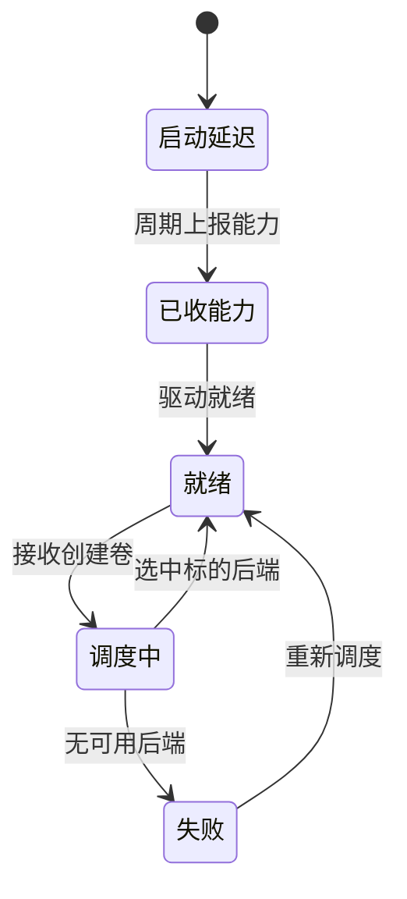

# Cinder 后台服务（RPC Server 与周期任务）组件

`cinder-volume`、`cinder-scheduler`、`cinder-backup` 三个二进制共用 `cinder/service.py` 的 `Service` 骨架：启动时先初始化 `Manager`，再以 `oslo_messaging` 建 RPC server，并把 `Manager` 及其 `additional_endpoints` 注册为 endpoint。周期任务由 `Manager` 继承的 `PeriodicTasks` 承载，多后端互斥由 Tooz 协调器提供的分布式锁兜底；`cinder-volume` 额外启动 per-backend 的第二个 RPC server 以兼容旧版直连路由。

## 1. 三类后台进程与启动入口

| 进程 | 入口符号与锚点 | 服务创建方式 | 并发与协调特征 |
|---|---|---|---|
| `cinder-volume` | `main` (`cinder/cmd/volume.py:70-119`) | 遍历 `CONF.enabled_backends`，为每个后端 `service.Service.create(host=backend_host 与 backend 以 @ 拼接, service_name=backend, binary='cinder-volume', coordination=True, cluster=cluster)` (`:84-98`) | 每个后端一个进程内 server；`session.dispose_engine()` (`:106`) 防止子进程共享数据库连接池；`launcher.launch_service(server)` (`:107`) |
| `cinder-scheduler` | `main` (`cinder/cmd/scheduler.py:45-56`) | `service.Service.create(binary='cinder-scheduler')` → `service.serve(server)` → `service.wait()` (`:54-56`) | 单实例，`coordination` 未开启；RPC 入口由 `SchedulerManager` 的 `target` 定义 |
| `cinder-backup` | `main` (`cinder/cmd/backup.py:47-60`) | `service.Service.create(binary='cinder-backup', coordination=True)` → `service.serve` → `service.wait()` (`:57-60`) | 开启 Tooz 协调；`priv_context.init(...)` (`:54`) 准备 rootwrap 提权上下文 |

三个入口都先做 `objects.register_all()` 与 `CONF(sys.argv[1:], project='cinder')`，`cinder-volume` 与 `cinder-backup` 额外调用 `priv_context.init(root_helper=shlex.split(utils.get_root_helper()))`（`cinder/cmd/volume.py:77`, `cinder/cmd/backup.py:54`）。全局 launcher 语义见 `cinder/service.py:639-681`：`serve()` 只允许调用一次，`wait()` 在 `KeyboardInterrupt` 时停止并 `rpc.cleanup()`，`get_launcher()` 在 Windows 上退回 `Launcher()`（`cinder/service.py:673-681`）。

## 2. 服务骨架与周期任务调用树

```text
cinder/cmd/volume.py:70 main()
  └─ service.Service.create(...) -> cinder/service.py:118-160 Service.__init__()
       ├─ [guard] rpc.initialized() 为假则 rpc.init(CONF) (:134-135)
       ├─ manager_class = importutils.import_class(self.manager_class_name) (:143)
       │    └─ CONF.profiler.enabled 为真时包一层 profiler.trace_cls("rpc") (:144-145)
       ├─ self.manager = manager_class(host, cluster, service_name, ...) (:148-151)
       └─ objects.Service.get_by_args(ctxt, host, binary) 写 rpc_current_version / object_current_version (:162-165)
            └─ Service.start() (cinder/service.py:232-269)
                 ├─ [if self.coordination] coordination.COORDINATOR.start() (:238-239)
                 ├─ self.manager.init_host(added_to_cluster, service_id) (:241-242)
                 ├─ endpoints = [self.manager] + self.manager.additional_endpoints (:247-248)
                 ├─ obj_version_cap = objects.Service.get_minimum_obj_version(ctxt) (:249)
                 │    └─ serializer = CinderObjectSerializer(obj_version_cap) (:252)
                 ├─ target = messaging.Target(topic=self.topic, server=self.host) (:254)
                 │    └─ self.rpcserver = rpc.get_server(target, endpoints, serializer).start() (:255-256)
                 └─ [if self.topic == constants.VOLUME_TOPIC] (:262)
                      └─ 额外 backend_rpcserver 订阅 topic 与 host 以点号拼接的复合主题 (:263-269)

cinder/manager.py:77-79 PeriodicTasks.__init__() -> super().__init__(CONF)
  ├─ cinder/manager.py:82-95 Manager: RPC_API_VERSION='1.0', target=messaging.Target(version=...), additional_endpoints=[], availability_zone=CONF.storage_availability_zone
  ├─ cinder/manager.py:154-160 ThreadPoolManager: self._tp = greenpool.GreenPool(); _add_to_threadpool() -> self._tp.spawn_n(func, ...)
  ├─ cinder/manager.py:163-213 SchedulerDependentManager
  │    ├─ update_service_capabilities(capabilities) -> self.last_capabilities (:181-183)
  │    └─ @periodic_task _publish_service_capabilities(context) (:185-195)
  │         ├─ scheduler_rpcapi.update_service_capabilities(context, service_name, host, last_capabilities, cluster)
  │         └─ scheduler_rpcapi.notify_service_capabilities(...); 捕获 exception.ServiceTooOld (:202-209)
  ├─ cinder/scheduler/manager.py:65-83 SchedulerManager(CleanableManager, Manager)
  │    ├─ self.driver = importutils.import_object(CONF.scheduler_driver) (:74-76)
  │    ├─ @periodic_task _clean_expired_messages (:98-101) -> message_api.cleanup_expired_messages
  │    ├─ @periodic_task _clean_expired_reservation (:103-106) -> QUOTAS.expire(context)
  │    └─ _wait_for_scheduler() (:143-147) 循环 eventlet.sleep(1) 直到 driver.is_ready()
  ├─ cinder/backup/manager.py:84-96 BackupManager(ThreadPoolManager)
  │    ├─ driver_name -> _map_service_to_driver(CONF.backup_driver) (:99-110)
  │    ├─ init_host (:118-127) -> setup_backup_backend(ctxt) -> _cleanup_incomplete_backup_operations(ctxt)
  │    └─ _setup_backup_driver (:129-133) -> check_for_setup_error() 后 raise loopingcall.LoopingCallDone
  └─ cinder/volume/manager.py:405-492 VolumeManager.init_host()
       ├─ [guard] driver.supported 为假且未开 enable_unsupported_driver -> return (:408-418)
       ├─ driver.do_setup(ctxt) -> driver.check_for_setup_error() (:429-430)
       ├─ driver.init_capabilities() (:440)
       ├─ _get_my_volumes / _get_my_snapshots -> _sync_provider_info (:442-444)
       ├─ [for volume in volumes] status in ('in-use','available') -> _count_allocated_capacity；in-use 再 ensure_export (:450-465)
       ├─ driver.set_throttle() / driver.set_initialized() (:473-478)
       └─ publish_service_capabilities(ctxt) (:485) -> super().init_host(...) (:491-492)
```

## 3. 周期任务与状态落点表

| 任务标识（Kind） | 触发源 | 间隔 / 配置键 | 执行主函数（`路径:行号`） | 产物落点 |
|---|---|---|---|---|
| 服务能力上报 | `SchedulerDependentManager` 周期任务 | `CONF.periodic_interval`（`cinder/manager.py:79` 注入 `PeriodicTasks`） | `_publish_service_capabilities` (`cinder/manager.py:185-195`) | 调度器 `HostManager.update_service_capabilities`（`cinder/scheduler/host_manager.py:463-475`） |
| 过期消息清理 | `SchedulerManager` 周期任务，立即执行一次 | `CONF.message_reap_interval` (`cinder/scheduler/manager.py:98-99`) | `_clean_expired_messages` (`cinder/scheduler/manager.py:100-101`) | `message_api.cleanup_expired_messages` |
| 过期预留清理 | `SchedulerManager` 周期任务，立即执行一次 | `CONF.reservation_clean_interval` (`cinder/scheduler/manager.py:103-104`) | `_clean_expired_reservation` (`cinder/scheduler/manager.py:105-106`) | `QUOTAS.expire(context)` |
| 备份后端初始化重试 | `loopingcall.FixedIntervalLoopingCall` | `CONF.periodic_interval` (`cinder/backup/manager.py:139`) | `_setup_backup_driver` (`cinder/backup/manager.py:129-133`) | `self.is_initialized = True`，成功抛 `LoopingCallDone` |
| 卷后端驱动初始化 | `Service.start()` 调用 `init_host` | 启动期一次性 | `VolumeManager.init_host` (`cinder/volume/manager.py:405-492`) | 驱动 `set_initialized()` 与 `publish_service_capabilities()` |
| RPC 后初始化 | `init_host_with_rpc` 钩子 | RPC server 启动后 | `VolumeManager.init_host_with_rpc` (`cinder/volume/manager.py:494-532`) | `Service.replication_status` 按 `stats['replication_enabled']` 写入并 `service.save()` |



`SchedulerManager._startup_delay` 在 `cinder/scheduler/manager.py:78` 初始化为真，`init_host_with_rpc` 中 `eventlet.sleep(CONF.periodic_interval)` 后置假（`:85-90`）；`_wait_for_scheduler()` 则以 `while self._startup_delay and not self.driver.is_ready()` 自旋（`:143-147`）。

## 4. 分布式协调与可靠性边界

| 契约维度 | 实现符号 | 源码锚点 | 语义与陷阱 |
|---|---|---|---|
| 成员标识 | `Coordinator.__init__` | `cinder/coordination.py:78-82` | `agent_id` 缺省为 `uuid4()` 字符串，`prefix` 默认由全局对象给定为 `cinder-`（`:116`） |
| 后端接入 | `Coordinator.start` | `cinder/coordination.py:84-93` | `member_id = (prefix + agent_id).encode('ascii')`；`coordination.get_coordinator(CONF.coordination.backend_url, member_id)` 后 `start(start_heart=True)`；重复调用直接返回 |
| 锁命名 | `Coordinator.get_lock` | `cinder/coordination.py:102-113` | 锁名同样 `encode('ascii')` 并拼 `prefix`；协调器为空抛 `exception.LockCreationFailed` |
| 临界区装饰 | `synchronized` | `cinder/coordination.py:119-163` | `blocking=True` 阻塞等锁，`False` 立即失败，数值按超时秒数处理；锁名支持 `{f_name}` 与被装饰函数参数格式化（`:151-158`） |
| 服务启停 | `Service.start` / `Service.stop` | `cinder/service.py:232-269`, `cinder/service.py:604-610` | `start()` 中协调器先于 `init_host` 启动；`stop()` 只停 WSGI/服务 server，协调器停止由 `Coordinator.stop`（`cinder/coordination.py:95-100`）负责 |
| 版本钉住 | `Service.start` | `cinder/service.py:249-256` | `get_minimum_obj_version` 决定 `CinderObjectSerializer` 的对象版本上限，滚动升级期间低版本消息不会带高版本字段 |

## 5. 核心源码符号表

| 源码文件 | 核心符号（`行号`） | 职责边界 |
|---|---|---|
| `cinder/cmd/volume.py` | `main` (`:70-119`) | 多后端实例编排与 launcher 持有 |
| `cinder/cmd/scheduler.py` | `main` (`:45-56`) | 单实例调度服务的创建与等待 |
| `cinder/cmd/backup.py` | `main` (`:47-60`) | 备份服务创建并开启协调 |
| `cinder/service.py` | `Service` (`:118-160`), `Service.start` (`:232-269`), `serve` (`:639-664`), `get_launcher` (`:673-681`) | RPC server 构建、版本钉住与进程生命周期 |
| `cinder/manager.py` | `PeriodicTasks` (`:77-79`), `Manager` (`:82-151`), `ThreadPoolManager` (`:154-160`), `SchedulerDependentManager` (`:163-213`) | 周期任务基类、endpoint 容器与能力上报 |
| `cinder/coordination.py` | `Coordinator` (`:67-113`), `COORDINATOR` (`:116`), `synchronized` (`:119-163`) | Tooz 封装与分布式锁装饰器 |
| `cinder/scheduler/manager.py` | `SchedulerManager` (`:65-83`), `init_host_with_rpc` (`:85-90`), `_wait_for_scheduler` (`:143-147`) | 调度 RPC endpoint 与调度器就绪判定 |
| `cinder/backup/manager.py` | `BackupManager` (`:84-110`), `init_host` (`:118-127`), `setup_backup_backend` (`:135-145`) | 备份 RPC endpoint 与驱动初始化重试 |
| `cinder/volume/manager.py` | `VolumeManager.init_host` (`:405-492`), `init_host_with_rpc` (`:494-532`) | 卷后端驱动初始化、重导出与能力发布 |

## 6. 共变耦合与修改清单

1. 新增后台进程二进制：在 `setup.cfg:48-56` 的 `console_scripts` 注册入口，并复用 `Service.create` + `service.serve` / `launcher.wait` 模式；新 `Manager` 必须显式设置 `RPC_API_VERSION` 与 `messaging.Target`，否则版本协商回落到 `cinder/manager.py:84` 的缺省 `'1.0'`。
2. 修改 RPC 序列化：调整 `cinder/service.py:249-256` 的 `obj_version_cap` 或 `CinderObjectSerializer` 时，必须同步 [数据底座组件](data-and-adapter.md) 的 OVO 版本注册与 [消息中间件契约](../integrations/downstream/rpc-messaging.md) 的 topic 约定，并验证滚动升级场景。
3. 调整 `additional_endpoints`（`cinder/service.py:247-248`）：新增 endpoint 时须确认其 `target` 版本与 manager 一致，否则 `rpc.get_server` 注册后不会收到预期 topic 的消息。
4. 改动能力上报：`cinder/manager.py:185-195` 与 `cinder/scheduler/manager.py:108-141` 的 `update_service_capabilities` / `notify_service_capabilities` 是成对链路；字段变更要同步 [调度引擎](core-engine.md) 中 `BackendState.update_from_volume_capability`（`cinder/scheduler/host_manager.py:146-206`）所消费的键。
5. 周期任务隔离：单测若不需要真实定时器，应通过 `CONF.periodic_interval` 调大或替换 `PeriodicTasks`，避免守护线程与临时目录竞争；`_clean_expired_messages` 与 `_clean_expired_reservation` 使用 `run_immediately=True`（`cinder/scheduler/manager.py:98-104`），启动即执行。
6. 引入新的跨进程互斥：沿用 `synchronized`（`cinder/coordination.py:119`），不要自建线程锁；锁名前缀固定为 `cinder-`（`:116`），改名会导致新旧版本无法互斥。
