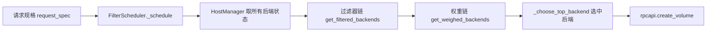

# Cinder 核心调度引擎与任务流引擎

本组件解决两个核心问题：把 `request_spec` 映射为唯一目标后端（过滤缩域、权重排序、选中后扣减容量），以及用 Taskflow `linear_flow` 把"校验 → 预留配额 → 建库记录 → 提交配额 → 下发 RPC"编排成可回滚的工作流。调度侧的关键不变量是**只读快照参与排序、选中后才可变消费**；任务流侧的关键不变量是**任务名由模块与类自动派生、失败时经统一通知与错误状态回写**。

## 1. 引擎核心不变量

1. **只读快照隔离不变量**：`BackendState.update_capabilities` 用 `ReadOnlyDict(capabilities)` 与 `ReadOnlyDict(service)` 包装上报的能力字典（`cinder/scheduler/host_manager.py:136-144`）；排序期间消费 `capabilities` 的过滤器不能污染底层字典。
2. **先过滤后消费不变量**：`FilterScheduler._schedule` 先拿 `_get_weighted_candidates` 的结果，再调用 `_choose_top_backend`，后者才执行 `backend_state.consume_from_volume(volume_properties)`（`cinder/scheduler/filter_scheduler.py:507-525`, `:540-546`）；容量扣减发生在 `BackendState.consume_from_volume` 中，对 `free_capacity_gb == 'infinite'` 与 `'unknown'` 两种值刻意跳过（`cinder/scheduler/host_manager.py:291-304`）。
3. **失败即闭环不变量**：调度失败时 `ScheduleCreateVolumeTask.execute` 先 `message_api.create` 记录动作，再在 `_handle_failure` 发通知并 `common.error_out(volume, reason=e)`；`NoValidBackend` 不重抛（`cinder/scheduler/flows/create_volume.py:93-138`）。



图中 `get_all_backend_states`、`get_filtered_backends`、`get_weighed_backends` 的调用顺序见 `cinder/scheduler/filter_scheduler.py:320-333`；选中后的 RPC 下发见 `cinder/scheduler/filter_scheduler.py:108-110`。

## 2. 核心类型层次与职责表

| 核心符号 | 源码锚点 | 持有的关键状态 | 职责与生命周期 |
|---|---|---|---|
| `FilterScheduler` | `cinder/scheduler/filter_scheduler.py:37-43` | `options = SchedulerOptions()`, `max_attempts`, `cost_function_cache` | 调度驱动入口，实现 `schedule_create_volume` / `schedule_create_group` |
| `BackendState` | `cinder/scheduler/host_manager.py:92-130` | `capabilities`, `total_capacity_gb`, `allocated_capacity_gb`, `free_capacity_gb`, `pools`, `updated` | 后端可变状态；`backend_id` 优先取 `cluster_name`（`:132-134`） |
| `PoolState` | `cinder/scheduler/host_manager.py:316-323` | `pool_name`, `pools = None` | 继承 `BackendState`，以 `append_host` 构造带池后缀的 host/cluster，禁止池嵌套 |
| `HostManager` | `cinder/scheduler/host_manager.py:361-390` | `service_states`, `backend_state_map`, `filter_classes`, `weight_classes` | 持有过滤器/权重器注册表，提供 `get_filtered_backends` / `get_weighed_backends`（`:447-461`） |
| `BaseFilter` | `cinder/scheduler/base_filter.py:26-56` | `run_filter_once_per_request` | `_filter_one` 判单个对象，`filter_all` 生成器逐个 yield 通过项 |
| `BaseWeigher` | `cinder/scheduler/base_weight.py:66-118` | `minval`, `maxval` | `_weigh_object` 抽象；`weigh_objects` 遍历并动态更新极值 |
| `CinderTask` | `cinder/flow_utils.py:36-48` | 由 `make_name` 派生的任务名 | 所有 Cinder Taskflow 任务的根类，经 `addons` 追加标识后缀 |
| `VolumeCastTask` | `cinder/volume/flows/api/create_volume.py:709-728` | `scheduler_rpcapi`, `volume_rpcapi`, `db` | 工作流末端把创建请求转交调度器或卷服务 |

`HostManager.REQUIRED_KEYS` (`cinder/scheduler/host_manager.py:366-375`) 规定池能力字典必须有 `pool_name`、`total_capacity_gb`、`free_capacity_gb`、`allocated_capacity_gb`、`provisioned_capacity_gb`、`thin_provisioning_support`、`thick_provisioning_support`、`max_over_subscription_ratio`、`reserved_percentage` 九个键。

## 3. 过滤与权重管线调用树

```text
FilterScheduler.schedule_create_volume (cinder/scheduler/filter_scheduler.py:89-110)
  ├─ _schedule(context, request_spec, filter_properties) (:507-525)
  │    └─ _get_weighted_candidates (:269-333)
  │         ├─ context.elevated() (:275)
  │         ├─ 复制 volume_XX 到 resource_XX 兼容 Oslo 与 Cinder 过滤器 (:277-279)
  │         ├─ host_manager.get_all_backend_states(elevated) (:320)
  │         ├─ host_manager.get_filtered_backends(backends, filter_properties) (:323-324)
  │         │    └─ BaseFilterHandler.get_filtered_objects -> BaseFilter.filter_all (cinder/scheduler/base_filter.py:35-44)
  │         └─ host_manager.get_weighed_backends(backends, filter_properties) (:331-332)
  │              └─ BaseWeightHandler.get_weighed_objects -> BaseWeigher.weigh_objects (cinder/scheduler/base_weight.py:92-118)
  │                   └─ normalize(weights, minval, maxval) (cinder/scheduler/base_weight.py:27-53)
  │                        └─ minval == maxval 时返回 [0] * len(weight_list) (:49-50)
  ├─ [if group_backend] 逆序剔除 backend_id 不匹配的候选 (:512-519)
  ├─ [if not weighed_backends] raise exception.NoValidBackend (:520-524)
  └─ _choose_top_backend (:540-546)
       ├─ top_backend = weighed_backends[0]
       ├─ backend_state.consume_from_volume(volume_properties)
       └─ driver.volume_update_db(context, volume_id, backend.host, backend.cluster_name) (:99-101)
            └─ self.volume_rpcapi.create_volume(..., allow_reschedule=True) (:108-110)

HostManager._choose_backend_filters (cinder/scheduler/host_manager.py:392-417)
  ├─ filter_cls_names 为 None 时取 CONF.scheduler_default_filters (:399-400)
  ├─ 按 cls.__name__ 精确匹配已加载类 (:407-411)
  └─ 未匹配项抛 exception.SchedulerHostFilterNotFound (:414-416)
HostManager._choose_backend_weighers (cinder/scheduler/host_manager.py:419-445)
  ├─ weigher_cls_names 为 None 时取 CONF.scheduler_default_weighers (:426-427)
  └─ 未匹配项抛 exception.SchedulerHostWeigherNotFound (:442-444)
```

`populate_filter_properties` 把 `size`、`availability_zone`、`user_id`、`metadata`、`qos_specs` 从 `request_spec['volume_properties']` 注入过滤属性字典（`cinder/scheduler/filter_scheduler.py:53-63`）；这是新增过滤器读取卷属性的事实来源。

## 4. 入口点注册表与关键常量表

> 过滤器与权重器通过 `setup.cfg` 的 `entry_points` 暴露，`HostManager.__init__` 用对应命名空间加载全部类（`cinder/scheduler/host_manager.py:380-386`）。

| 类别 | 入口点名称到实现的映射 | 源码锚点 |
|---|---|---|
| 过滤器 | `AvailabilityZoneFilter`、`CapabilitiesFilter`、`CapacityFilter`、`DifferentBackendFilter`、`DriverFilter`、`JsonFilter`、`RetryFilter`、`SameBackendFilter`、`InstanceLocalityFilter` | `setup.cfg:28-37` |
| 权重器 | `AllocatedCapacityWeigher`、`CapacityWeigher`、`ChanceWeigher`、`GoodnessWeigher`、`VolumeNumberWeigher` | `setup.cfg:38-43` |
| 过滤命名空间 | `cinder.scheduler.filters`，由 `filters.BackendFilterHandler` 加载 | `cinder/scheduler/host_manager.py:380-382` |
| 权重命名空间 | `cinder.scheduler.weights`，由 `CONF.scheduler_weight_handler` 指定 handler 加载 | `cinder/scheduler/host_manager.py:383-386` |

| 关键常量 / 阈值 | 代码值或语义 | 源码位置 | 修改影响 |
|---|---|---|---|
| `ACTION` | `'volume:create'` | `cinder/scheduler/flows/create_volume.py:28` | Taskflow 任务名与失败主题的前缀来源 |
| `FAILURE_TOPIC` | `"scheduler.create_volume"` | `cinder/scheduler/flows/create_volume.py:85` | 调度失败通知主题，消费端需同步 |
| `run_filter_once_per_request` | `False` | `cinder/scheduler/base_filter.py:48` | 为真时 `run_filter_for_index` 仅对第 0 个实例运行（`cinder/scheduler/base_filter.py:50-56`） |
| `normalize` 等值分支 | 全等时返回全零列表 | `cinder/scheduler/base_weight.py:49-50` | 所有候选权重相同时退化为列表顺序而非随机 |
| `BaseWeigher.weight_multiplier` | 缺省 `1.0` | `cinder/scheduler/base_weight.py:79-86` | 子类应改为读取配置项以允许运维调权 |
| `BackendState.backend_id` | `cluster_name or host` | `cinder/scheduler/host_manager.py:132-134` | 集群模式下候选去重用 cluster 名而非 host 名 |

## 5. 任务流引擎与事务边界

```text
cinder/volume/flows/api/create_volume.py:818-851 get_flow(db_api, image_service_api, availability_zones, create_what, ...)
  └─ flow_name = ACTION.replace(":", "_") + "_api" -> linear_flow.Flow (:832-833)
       ├─ ExtractVolumeRequestTask (:835-840) rebind raw_size / raw_availability_zone / raw_volume_type
       ├─ QuotaReserveTask (:841) 预留配额，失败回滚
       ├─ EntryCreateTask (:842) 写数据库条目
       ├─ QuotaCommitTask (:843) 提交配额
       └─ [if scheduler_rpcapi and volume_rpcapi] VolumeCastTask (:845-848)
            └─ taskflow.engines.load(api_flow, store=create_what) (:851) 仅装载不执行

cinder/scheduler/flows/create_volume.py:141-175 get_flow(context, driver_api, request_spec, ...)
  └─ linear_flow.Flow("volume_create_scheduler") (:163-164)
       ├─ ExtractSchedulerSpecTask (:167-168) request_spec 为 None 时由 _populate_request_spec 重建 (:43-62)
       └─ ScheduleCreateVolumeTask(driver_api) (:172)
            └─ execute (:119-138)
                 ├─ driver_api.schedule_create_volume(context, request_spec, filter_properties)
                 ├─ [except] message_api.create(Action.SCHEDULE_ALLOCATE_VOLUME, ...)
                 ├─ _handle_failure -> _notify_failure -> rpc.get_notifier('scheduler').error(FAILURE_TOPIC, payload)
                 └─ common.error_out(volume, reason=e)；NoValidBackend 不重抛 (:133-134)
```

`VolumeCastTask._cast_create_volume` 决定下发目标：存在 `cgroup_id` 时从 `objects.ConsistencyGroup` 取 host 写入 `request_spec['CG_backend']`；存在 `group_id` 时写入 `request_spec['group_backend']`；`snapshot_same_host` 为真时直接定位快照所在卷；其余情况 cast 给调度器（`cinder/volume/flows/api/create_volume.py:730-768`）。`flow_utils.CinderTask` 的任务名经 `_make_task_name` 与 `addons` 拼接（`cinder/flow_utils.py:32-48`），`SpecialFormatter` 对 `InvalidInput` 与 `QuotaError` 不打印回溯（`cinder/flow_utils.py:51-65`）。

## 6. 核心源码符号表

| 源码文件 | 核心符号（`行号`） | 职责边界 |
|---|---|---|
| `cinder/scheduler/filter_scheduler.py` | `FilterScheduler` (`:37-43`), `schedule_create_volume` (`:89-110`), `_get_weighted_candidates` (`:269-333`), `_schedule` (`:507-525`), `_choose_top_backend` (`:540-546`) | 调度主流程与后端选中 |
| `cinder/scheduler/host_manager.py` | `BackendState` (`:92-130`), `consume_from_volume` (`:291-304`), `PoolState` (`:316-323`), `HostManager` (`:361-390`), `get_filtered_backends` / `get_weighed_backends` (`:447-461`) | 后端状态模型与过滤/权重执行器 |
| `cinder/scheduler/base_filter.py` | `BaseFilter` (`:26-56`), `BaseFilterHandler` (`:59`) | 过滤器契约与一次性运行标志 |
| `cinder/scheduler/base_weight.py` | `normalize` (`:27-53`), `WeighedObject` (`:56-63`), `BaseWeigher` (`:66-118`), `BaseWeightHandler` (`:121-124`) | 权重归一化与排序契约 |
| `cinder/flow_utils.py` | `CinderTask` (`:36-48`), `SpecialFormatter` (`:51-65`), `DynamicLogListener` (`:68`) | 任务命名与失败日志策略 |
| `cinder/scheduler/flows/create_volume.py` | `ExtractSchedulerSpecTask` (`:31-72`), `ScheduleCreateVolumeTask` (`:75-138`), `get_flow` (`:141-175`) | 调度侧工作流与失败通知 |
| `cinder/volume/flows/api/create_volume.py` | `ExtractVolumeRequestTask` (`:55`), `QuotaReserveTask` (`:600`), `QuotaCommitTask` (`:662`), `VolumeCastTask` (`:709-768`), `get_flow` (`:818-851`) | 接口侧工作流与下发决策 |
| `setup.cfg` | `cinder.scheduler.filters` (`:28-37`), `cinder.scheduler.weights` (`:38-43`) | 插件入口点注册表 |

## 7. 共变耦合与修改清单

1. 新增过滤器或权重器：在 `setup.cfg:28-43` 注册入口点 → 在 `cinder/scheduler/host_manager.py:392-445` 确认类名精确匹配逻辑能识别 → 更新 `CONF.scheduler_default_filters` / `CONF.scheduler_default_weighers` 的缺省值 → 同步 [配置字典](../contracts/configuration.md) 与调度业务页 [调度流程](../business/scheduling.md)。
2. 变更能力字典字段：`cinder/scheduler/host_manager.py:366-375` 的 `REQUIRED_KEYS` 与 `update_from_volume_capability`（`:146-206`）必须同步；上游写入方在 [后台服务组件](async-job-worker.md) 的 `publish_service_capabilities`，漏改会导致候选后端因缺键被丢弃。
3. 修改选中语义：动到 `FilterScheduler._choose_top_backend`（`cinder/scheduler/filter_scheduler.py:540-546`）就要复核 `BackendState.consume_from_volume`（`cinder/scheduler/host_manager.py:291-304`）的容量扣减，以及 `_post_select_populate_filter_properties`（`:102-103`）回填给卷服务的属性。
4. 调整工作流任务顺序：`cinder/volume/flows/api/create_volume.py:835-848` 的 `add` 顺序决定回滚语义，配额预留必须在建库之前；改动后必须验证 `QuotaReserveTask`（`:600`）与 `QuotaCommitTask`（`:662`）的失败补偿路径。
5. 修改失败通知：`cinder/scheduler/flows/create_volume.py:85` 的 `FAILURE_TOPIC` 与 `:103-113` 的 payload 键（`request_spec`、`volume_properties`、`volume_id`、`state`、`method`、`reason`）属于消费方契约，变更需同步 [消息中间件契约](../integrations/downstream/rpc-messaging.md)。
6. 任务重命名风险：`cinder/flow_utils.py:43-48` 用类与模块自动派生任务名，重命名 `CinderTask` 子类会改变日志与回滚匹配键，需同步更新依赖任务名的测试断言。
