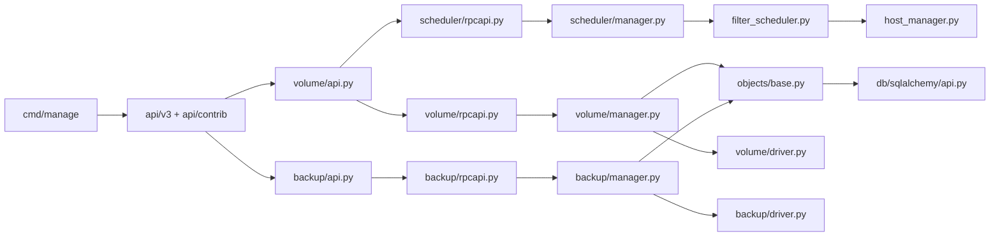

# 仓内模块依赖矩阵与影响面图谱

Cinder 的调用边以 RPC 与共享 DB 为主要耦合介质：API 与 Manager 之间不共享内存对象，统一经 OVO 序列化；调度器只依赖 HostManager 的能力快照，不直接持有驱动实例。本节刻画真实调用边与高扇入底座，评估重构爆炸半径。

## 1. 模块依赖拓扑图

## 2. 模块×模块真实调用边明细

| 调用方模块（Caller） | 被调方模块（Callee） | 耦合介质（Import 调用 / 线程队列 / 子进程 / 共享表） | 契约符号 | 证据锚点（`路径:行号`） |
|---|---|---|---|---|
| `api-wsgi` | `volume-api` | 同步函数调用 | `self.volume_api.create` | `cinder/api/v3/router.py:50-62`（路由注册）、`cinder/api/v3/volumes.py:197-331`、`cinder/volume/api.py:218` |
| `volume-api` | `scheduler-rpc` | RPC cast | `scheduler_rpcapi.create_volume` | `cinder/volume/flows/api/create_volume.py:730-789` |
| `scheduler-rpc` | `scheduler-engine` | RPC cast → Topic 消费 | `SchedulerManager.create_volume` | `cinder/scheduler/rpcapi.py:94-101`、`cinder/scheduler/manager.py:175` |
| `scheduler-engine` | `host-manager` | 同步函数调用 | `HostManager.get_pools` / `consume_from_volume` | `cinder/scheduler/filter_scheduler.py:507-546`、`cinder/scheduler/host_manager.py:92` |
| `volume-api` | `volume-manager` | RPC cast → Topic 消费 | `VolumeManager.create_volume` | `cinder/volume/rpcapi.py`、`cinder/volume/manager.py:583` |
| `backup-api` | `backup-manager` | RPC cast（定向 `backup.host`） | `BackupManager.create_backup` | `cinder/backup/rpcapi.py:56-59`、`cinder/backup/manager.py:279`；服务装配由 `cinder/service.py:232-269` 完成 |
| `cli-admin` | `db-dao` | 动态 entry_points + 直接 DB 查询 | `ServiceCommands`、`DbCommands.sync` | `setup.cfg:48-56`、`cinder/cmd/manage.py:531` |
| 各 Manager | `db-dao` | OVO → SQLAlchemy 函数调用 | `objects.Volume.get_by_id`、`db.volume_update` | `cinder/objects/volume.py:52`、`cinder/backup/manager.py:283` |
| `volume-manager` | `driver-plugins` | 动态 import + 接口调用 | `self.driver.create_volume` | `cinder/interface/util.py:42-60`、`cinder/volume/manager.py:583-615` |
| `backup-manager` | `brick` / `volume-rpc` | 同步调用 + RPC call | `brick_get_connector_properties`、`volume_rpcapi.get_backup_device` | `cinder/backup/manager.py:388-392`、`cinder/utils.py:463` |
| `api-wsgi` | `external-adapters` | HTTP SDK（glanceclient/novaclient） | `GlanceClientWrapper.call`、`nova.volumes.update_server_volume` | `cinder/image/glance.py:179-198`、`cinder/compute/nova.py:212-217` |
| `cli-admin` | `db-dao` / `rpc-services` | 直接 DB 查询 + RPC | `DbCommands.sync`、`ServiceCommands` | `cinder/cmd/manage.py:205,531,699-711` |

## 3. 变更爆炸半径与架构审计（Blast-Radius Audit）

- **高扇入核心底座（High Fan-In — 改签名必须全仓搜索调用点并跑全量单测）**：
  1. `cinder/objects/base.py:157` `CinderObject`：所有 OVO 的基类，被 `cinder/objects/*.py` 全量继承，改字段校验或序列化会影响所有 RPC 载荷。
  2. `cinder/db/sqlalchemy/api.py:274` `model_query`：所有 DAO 查询的统一入口，改软删除视图会改变全部资源列表语义。
  3. `cinder/rpc.py:55` `rpc.init` / `:141` `get_client` / `:150` `get_server`：三类服务共享的传输层，改序列化器需同步校验 `RequestContextSerializer` (`:104-138`)。
  4. `cinder/manager.py:77` `PeriodicTasks` 与 `:82` `Manager`：三类 Manager 的公共基类，改周期任务调度语义影响全局状态收敛。
  5. `cinder/volume/driver.py:2114` `VolumeDriver`：30+ 厂商驱动的契约基类，新增抽象方法会破坏所有下游驱动实现。
  6. `cinder/exception.py:76` `CinderException`：288 个异常的基类，`code` 属性直接映射 HTTP 状态（见 [错误码字典](../contracts/error-codes.md)）。
- **循环依赖与函数内延迟导入（Lazy Import）记录**：`cinder/volume/manager.py` 内部大量在方法体中 `from cinder import ...` 的写法用于规避 manager 与 flow 模块的循环引用；插件驱动通过 `cinder/interface/util.py:42` 在运行时按配置字符串 import，静态分析无法穷举实际装载的驱动。
- **内嵌子仓 / 跨进程边界约定**：`cinder/brick/local_dev/` 与 `cinder/volume/drivers/` 属于同进程内嵌驱动资产；`oslo.privsep` 通过 `cinder/cmd/volume.py:77` 初始化，实际提权走 `cinder/utils.py:459` 的 rootwrap 子进程，修改 rootwrap 规则需同步 `etc/cinder/rootwrap.conf` 与 `etc/cinder/rootwrap.d/`。

## 4. 跨仓依赖矩阵（`repo_deps` · 单仓模式）

本工作区为单仓模式，外部依赖均为进程外黑盒（Glance、Nova、Swift、Barbican、FC 交换机、存储阵列）而非受控仓库，故无 `repo_deps` 跨仓边；其请求字典与返回解包契约见 [集成总览](../integrations/index.md) 与各 [下游契约](../integrations/downstream/glance.md)。

- **跨仓环检测结论**：不适用（单仓工作区）。即时依赖方向为 API → Scheduler → Volume → Driver/DB，无仓内循环导入闭环；插件的运行时 import 通过接口层隔离。

## 5. 共变耦合与修改清单（Co-Change Playbook）

1. 改 `cinder/volume/driver.py` 抽象接口：逐一检查 `cinder/volume/drivers/*` 与 `cinder/tests/unit/volume/drivers/*` 的实现是否提供新方法，详见 [存储驱动契约](../integrations/downstream/storage-drivers.md)。
2. 改 OVO 字段：必须同步 `cinder/db/sqlalchemy/models.py` 列定义、`cinder/objects/fields.py` 枚举、`cinder/objects/*` 的 `fields` 声明与 RPC 版本（见 [领域模型总览](../business/domain-models/index.md)）。
3. 改 RPC Topic 或序列化：同步 `cinder/common/constants.py:21-27`、`cinder/rpc.py:104-159` 与三个 `rpcapi.py` 的版本史，并跑 `cinder/tests/unit/test_rpc.py` 与相关 RPCAPI 用例。
