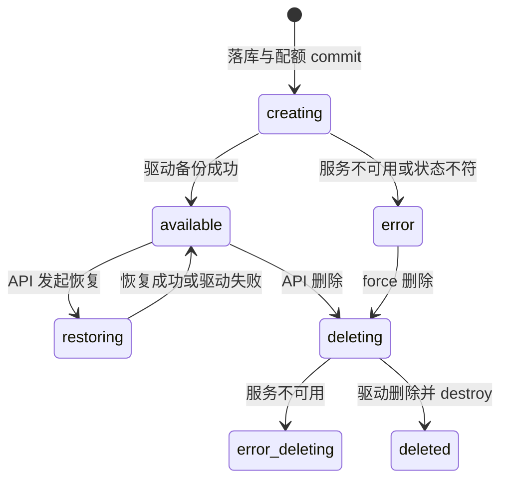

# WF-03 · 备份创建 / 恢复 / 删除 / 导入导出

备份流由 cinder-api 做状态守卫与配额三阶段提交，再由 cinder-backup 通过 RPC 异步驱动后端（默认 Swift）读写对象；产物是 `backups` 表记录、`backup_metadata` 与 Swift 容器对象。创建走 `creating → available`，恢复走 `restoring → available`，删除走 `deleting → 物理对象移除 + 配额回收`。字段权威字典见 [`business/domain-models/backup.md`](../business/domain-models/backup.md)，Swift 对象字典见 [`integrations/downstream/swift-backup.md`](../integrations/downstream/swift-backup.md)，配额接口见 [`business/quotas.md`](../business/quotas.md)。

## 1. 符号级端到端执行调用树

```text
Trigger: POST /v3/{project_id}/backups -> cinder/backup/api.py:203 API.create(context, name, description, volume_id, container, incremental, ...)
  ├─ [源状态] cinder/backup/api.py:220-233 snapshot['status'] not in ["available"] -> InvalidSnapshot；volume['status'] not in ["available","in-use"] -> InvalidVolume；in-use 且 not force -> InvalidVolume
  ├─ [主机选择] cinder/backup/api.py:236-238 _get_available_backup_service_host(volume_utils.extract_host(volume.host, 'host'), volume.availability_zone)
  ├─ [配额预留] cinder/backup/api.py:241-249 reserve({'backups': 1, 'backup_gigabytes': volume['size']})，OverQuota 时 process_reserve_over_quota
  ├─ [准入] cinder/backup/api.py:287 if latest_backup['status'] != fields.BackupStatus.AVAILABLE -> InvalidBackup("parent backup must be available")
  ├─ [源置位] cinder/backup/api.py:293-302 snapshot_id 时 snapshot_update(status=BACKING_UP)，否则 volume_update(status='backing-up', previous_status=...)
  ├─ [落库] cinder/backup/api.py:306-325 objects.Backup(**kwargs).create()；status=CREATING，非快照时 data_timestamp = created_at
  ├─ [配额] cinder/backup/api.py:326 QUOTAS.commit(context, reservations)；异常时 destroy + QUOTAS.rollback
  └─ cinder/backup/api.py:338 backup_rpcapi.create_backup(context, backup)
       └─ cinder/backup/manager.py:279 BackupManager.create_backup
            ├─ :303-306 backup.host/service/availability_zone 写回并 save
            ├─ :308-328 严格状态校验：有快照时 snapshot['status'] == "backing-up"，否则 volume['status'] == "backing-up"
            ├─ :330-340 backup['status'] == fields.BackupStatus.CREATING，否则 _update_backup_error
            ├─ :343 if not self.is_working() -> InvalidBackup("backup service is down")
            ├─ :347 updates = self._run_backup(context, backup, volume)
            │    └─ cinder/backup/manager.py:385 _run_backup: volume_rpcapi.get_backup_device -> _attach_device -> backup_service.backup(backup, device_file/device_path) -> _detach_device(force=True, ignore_errors=True)
            ├─ :360-367 源状态复位 previous_status，previous_status 置 'backing-up'
            ├─ :368-373 backup.status = AVAILABLE，backup.size = volume['size']
            └─ :377-381 if backup.parent_id -> parent_backup.num_dependent_backups += 1

Trigger: POST /v3/{project_id}/backups/{id}/restore -> cinder/backup/api.py:342 API.restore
  ├─ cinder/backup/api.py:346 if backup['status'] != AVAILABLE -> InvalidBackup
  ├─ cinder/backup/api.py:350-353 if backup['size'] is None -> InvalidBackup("invalid size")
  ├─ cinder/backup/api.py:357-379 volume_id 为空则 volume_api.create(size, 'restore_backup_%s' % backup_id, ...) 并轮询至 status != 'creating'
  ├─ cinder/backup/api.py:383-393 目标卷必须 'available' 且 size >= backup size
  ├─ cinder/backup/api.py:401-407 backup.status = RESTORING；backup.restore_volume_id = volume.id；volume status 'restoring-backup'
  └─ cinder/backup/manager.py:426 BackupManager.restore_backup
       ├─ :438-447 volume['status'] != 'restoring-backup' -> InvalidVolume，backup 回 AVAILABLE
       ├─ :449-458 backup['status'] != RESTORING -> InvalidBackup 且 volume 置 'error'
       ├─ :469-482 _map_service_to_driver(backup['service']) != self.driver_name -> InvalidBackup，卷置 'error'
       ├─ :485 self._run_restore -> backup_service.restore(backup, volume.id, device_file/device_path)
       └─ :493-495 volume status 'available'，backup.status AVAILABLE

Trigger: DELETE /v3/{project_id}/backups/{id} -> cinder/backup/api.py:85 API.delete
  ├─ :97-100 not force and status not in [AVAILABLE, ERROR] -> InvalidBackup
  ├─ :101-104 force 且 _check_support_to_force_delete=False -> NotSupportedOperation
  ├─ :108-111 get_all(search_opts={'parent_id': backup.id}) 非空 -> InvalidBackup("Incremental backups exist")
  ├─ :113-116 backup.status = DELETING；_get_available_backup_service_host
  └─ cinder/backup/manager.py:528 BackupManager.delete_backup
       ├─ :536-544 backup.status != DELETING -> _update_backup_error + InvalidBackup
       ├─ :546-550 not is_working() -> ERROR_DELETING
       ├─ :552-570 驱动不一致或 delete_backup 异常 -> InvalidBackup
       ├─ :574-583 reserve({'backups': -1, 'backup_gigabytes': -backup.size})，失败仅记日志
       ├─ :585 backup.destroy()
       └─ :588-593 parent_id 且 has_dependent_backups -> num_dependent_backups -= 1；:595-597 QUOTAS.commit

Trigger: 导入导出
  ├─ cinder/backup/manager.py:612 export_record: :627 status != AVAILABLE -> InvalidBackup；:636 backup_record = {'backup_service': backup.service}
  └─ cinder/backup/manager.py:700 import_record: :702 backup.decode_record(backup_url) -> :705 driver_options = backup_options.pop('driver_info', {})
       ├─ :713-730 required_import_options = {display_name, display_description, container, size, service_metadata, object_count, id} 缺一即 InvalidBackup
       ├─ :733-739 backup_options['id'] != backup.id -> InvalidBackup
       ├─ :742-750 覆写 service/availability_zone/host 并剔除 name/user_id/project_id/deleted_at/deleted/fail_reason/status
       └─ :757-772 BackupDriverWithVerify 时 verify(backup.id)，最终 status = AVAILABLE
```

## 2. 分阶段业务规则与精确判定表

| 阶段 | 负责函数（`路径:行号`） | 精确布尔条件 / 阈值常量 | 命中分支行为 | 状态或数据副作用 |
|---|---|---|---|---|
| 快照源准入 | `API.create` (`cinder/backup/api.py:211-224`) | `volume_id != snapshot.volume_id` 或 `snapshot['status'] not in ["available"]` | 抛 `InvalidVolume` / `InvalidSnapshot` | 不预留配额 |
| 卷源准入 | `API.create` (`cinder/backup/api.py:225-233`) | `volume['status'] not in ["available","in-use"]`，或 `volume['status'] in ["in-use"] and not force` | 抛 `InvalidVolume`（in-use 必须带 force） | 不预留配额 |
| 备份配额预留 | `API.create` (`cinder/backup/api.py:241-249`) | `QUOTAS.reserve({'backups': 1, 'backup_gigabytes': volume['size']})` 抛 `OverQuota` | `process_reserve_over_quota(context, e, resource='backups', size=volume.size)` | 未取得 reservations |
| 父备份可增量 | `API.create` (`cinder/backup/api.py:287-290`) | `latest_backup['status'] != fields.BackupStatus.AVAILABLE` | 抛 `InvalidBackup("The parent backup must be available for incremental backup.")` | 不创建子备份 |
| 快照源置位 | `API.create` (`cinder/backup/api.py:293-298`) | `if snapshot_id` | `snapshot_update(status=SnapshotStatus.BACKING_UP)`；`data_timestamp = snapshot.created_at` | 快照进入 `backing-up` |
| 卷源置位 | `API.create` (`cinder/backup/api.py:299-302`) | `else` | `volume_update(status='backing-up', previous_status=调用前的卷状态字面量)` | 卷进入 `backing-up` |
| 备份状态预置 | `API.create` (`cinder/backup/api.py:312`、`321-326`) | `status = BackupStatus.CREATING` | 落库后 commit 配额；异常则 `backup.destroy()` + `QUOTAS.rollback` | `backups` 行存在 |
| 管理器源状态校验 | `BackupManager.create_backup` (`cinder/backup/manager.py:308-328`) | `actual_status != "backing-up"` | 抛 `InvalidSnapshot` / `InvalidVolume`，`_update_backup_error` | backup 置 error |
| 管理器备份状态校验 | `BackupManager.create_backup` (`cinder/backup/manager.py:330-340`) | `backup.status != BackupStatus.CREATING` | 抛 `InvalidBackup` | `_update_backup_error` + save |
| 服务存活性 | `BackupManager.create_backup` (`cinder/backup/manager.py:343-346`) | `not self.is_working()` | 抛 `InvalidBackup("backup service is down")` | backup 置 error |
| 设备路径分支 | `BackupManager._run_backup` (`cinder/backup/manager.py:398-413`) | `isinstance(device_path, six.string_types) and not os.path.isdir(device_path)` | 是文件路径时按 `backup_device.secure_enabled` 决定是否 `temporary_chown`；否则直接把 file-like 传给驱动 | 始终 `finally` 强制 detach |
| 增量父计数 | `BackupManager.create_backup` (`cinder/backup/manager.py:377-381`) | `if backup.parent_id` | `parent_backup.num_dependent_backups += 1` | 父备份计数 +1 |
| 目标卷容量 | `API.restore` (`cinder/backup/api.py:389-393`) | `size > volume['size']` | 抛 `InvalidVolume("volume size ... is too small")` | 不发起恢复 |
| 恢复驱动一致性 | `BackupManager.restore_backup` (`cinder/backup/manager.py:469-482`) | `_map_service_to_driver(backup['service']) != self.driver_name` | backup 回 `AVAILABLE`，volume 置 `error`，抛 `InvalidBackup` | 拒绝跨驱动恢复 |
| 卷大于备份 | `BackupManager.restore_backup` (`cinder/backup/manager.py:460-467`) | `volume['size'] > backup['size']` | 仅 `LOG.info("continuing with restore.")`，不拦截 | 继续恢复 |
| 恢复异常 | `BackupManager.restore_backup` (`cinder/backup/manager.py:486-491`) | `_run_restore` 抛任意异常 | volume 置 `error_restoring`，backup 回 `AVAILABLE` | 保留备份供重试 |
| 删除状态 | `BackupManager.delete_backup` (`cinder/backup/manager.py:536-544`) | `backup.status != BackupStatus.DELETING` | `_update_backup_error` + `InvalidBackup` | 不动物理对象 |
| 删除增量依赖 | `API.delete` (`cinder/backup/api.py:108-111`) | `deltas and len(deltas)` | 抛 `InvalidBackup("Incremental backups exist for this backup.")` | 父备份保留 |
| 导入必填字段 | `BackupManager.import_record` (`cinder/backup/manager.py:713-730`) | `required_import_options - set(backup_options)` 非空 | 抛 `InvalidBackup("missing fields (...)")` | `_update_backup_error` |
| 导入 ID 一致 | `BackupManager.import_record` (`cinder/backup/manager.py:733-739`) | `backup_options['id'] != backup.id` | 抛 `InvalidBackup`，拒绝跨记录导入 | 不写库 |
| Swift 认证 | `SwiftBackupDriver.initialize` (`cinder/backup/drivers/swift.py:165-195`) | `CONF.backup_swift_auth == 'single_user'` 且 `backup_swift_user is None`；或 `backup_swift_auth_url is None` 且 `keystone_catalog_info.split(':')` 的 `ValueError` | 分别抛 `ParameterNotFound` / `BackupDriverException` | 驱动不可用 |

## 3. 实体状态机与合法迁移约束



- **枚举权威来源**：`BackupStatus` 的全部合法字面量为 `error` / `error_deleting` / `creating` / `available` / `deleting` / `deleted` / `restoring`，定义于 `cinder/objects/fields.py:31-41`；快照侧 `SnapshotStatus` 的 `backing-up` / `restoring` / `unmanaging` 等字面量定义于 `cinder/objects/fields.py:119-132`。禁止发明其它状态。
- **不可违反的不变量 1**：非 force 删除只允许 `AVAILABLE` 或 `ERROR` 两个入口（`cinder/backup/api.py:97-100`）；`force=True` 还需 `_check_support_to_force_delete(backup.host)` 为真（`:101-104`）。
- **不可违反的不变量 2**：`num_dependent_backups` 是增量链完整性守卫：创建子备份时 +1（`cinder/backup/manager.py:380`），删除子备份时仅当 `has_dependent_backups` 为真才 -1（`:591-593`）；父备份只要仍有增量子备份就拒绝删除（`cinder/backup/api.py:108-111`）。
- **不可违反的不变量 3**：恢复后备份状态无条件回到 `AVAILABLE`（成功 `:494`、失败 `:490`），备份对象不会因恢复失败而变成 `error`；失败落在目标卷的 `error_restoring`。
- **不可违反的不变量 4**：`import_record` 的 ID 必须与新建 backup 对象 ID 完全一致（`cinder/backup/manager.py:733-739`），且 `driver_info` 是唯一传给驱动的嵌套键（`:705`），其余键必须落在必填集合内。

## 4. 幂等、并发互斥与异常补偿回滚表

| 边界 / 故障场景 | 源码检测条件（`路径:行号`） | 保护 / 回滚 / 降级动作 |
|---|---|---|
| 备份落库后 RPC 前崩溃 | `cinder/backup/api.py:327-333` | `except Exception` 中 `backup.destroy()` 后 `QUOTAS.rollback`，避免孤儿备份占额 |
| 备份驱动调用异常 | `cinder/backup/manager.py:348-358` | 快照源回 `AVAILABLE`，卷源回 `previous_status` 且 `previous_status='error_backing-up'`，backup `_update_backup_error` |
| 设备挂载/卸载残留 | `cinder/backup/manager.py:415-419`、`:524-526` | 无论 `backup_service.backup/restore` 是否成功，`finally` 调 `_detach_device(force=True)`；备份侧额外 `ignore_errors=True` |
| 临时卷/快照清理 | `cinder/backup/manager.py:420-423` | `_run_backup` 外层 `finally` 重读 backup 并调 `_cleanup_temp_volumes_snapshots_when_backup_created` |
| 恢复目标卷过大 | `cinder/backup/manager.py:460-467` | 不拒绝，记日志后继续以备份 size 覆盖数据 |
| 删除时配额预留失败 | `cinder/backup/manager.py:581-583` | `reservations = None`，仅 `LOG.exception`；`backup.destroy()` 仍执行，靠用量同步兜底 |
| 导入驱动不支持 verify | `cinder/backup/manager.py:757-765` | 非 `BackupDriverWithVerify` 实例时 `LOG.warning` 跳过校验，仍置 `AVAILABLE` |
| 备份服务主机选择 | `cinder/backup/api.py:176-185` | `not host or not CONF.backup_use_same_host` 时随机挑选 AZ 匹配且 `is_up` 的服务；无可用主机抛 `ServiceNotFound('cinder-backup')` |

## 5. 共变耦合与修改清单（Agent Co-Change Playbook）

- **修改本流程业务规则时必查联动点**：
  1. API 状态守卫与配额：`cinder/backup/api.py:85-117`、`:203-340`、`:342-409`；契约见 [`contracts/api/v3-other.md`](../contracts/api/v3-other.md)。
  2. 管理器状态机与增量计数：`cinder/backup/manager.py:279-424`、`:528-600`、`:700-777`，字段归属见 [`business/domain-models/backup.md`](../business/domain-models/backup.md)。
  3. Swift 对象组装原语：`cinder/backup/drivers/swift.py:315-375`（`put_container` / `get_container_entries` / `get_object_writer` / `get_object_reader` / `delete_object` / `_generate_object_name_prefix` / `get_extra_metadata`），下游字典契约见 [`integrations/downstream/swift-backup.md`](../integrations/downstream/swift-backup.md)。
  4. 枚举字面量：`cinder/objects/fields.py:31-41`、`119-132`；前端展示同步同样引用该枚举，状态值变更属破坏性变更。
  5. 配额资源注册：`cinder/quota.py:1136-1142` 的 `backups` / `backup_gigabytes`；预留超限处理见 `cinder/quota_utils.py:49-76`，语义见 [`business/quotas.md`](../business/quotas.md)。
  6. 源卷状态回写与卷生命周期：`cinder/backup/manager.py:354-357`、`:365-367`，与 [`business/volume-lifecycle.md`](../business/volume-lifecycle.md) 共享 `previous_status` 字段。
- **隐式陷阱**：`export_record` 只输出 `backup_service` 与驱动生成的 `backup_url`（`cinder/backup/manager.py:636`），`import_record` 会强制剔除 `status`/`user_id`/`project_id`（`:748-750`）；若新增备份字段，必须判断它是随记录迁移（加入 `required_import_options`）还是由新项目重新生成（加入剔除列表）。
