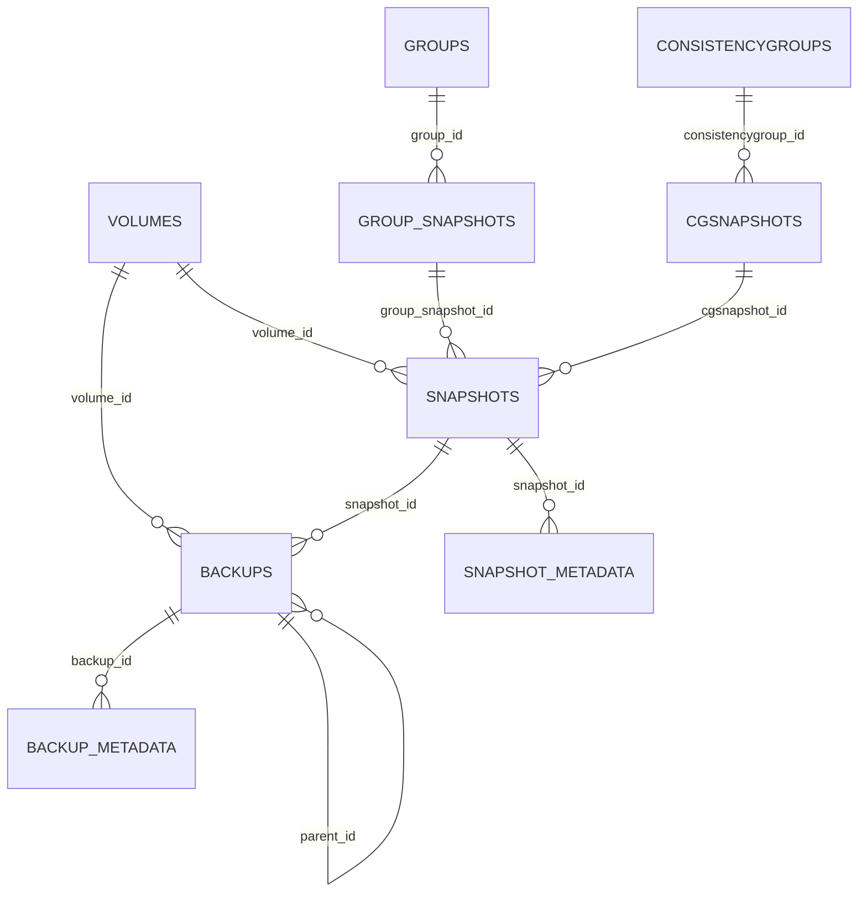

# Backup / Snapshot / Group 聚合字段字典与 Writer / Reader

三个聚合分别落在 `backups`、`snapshots`、`groups` / `consistencygroups` / `group_snapshots` / `cgsnapshots` 表，ORM 定义集中于 `cinder/db/sqlalchemy/models.py:159-237`、`:656-770`；OVO 版本分别为 `Backup VERSION='1.5'`（`cinder/objects/backup.py:42`）、`Snapshot VERSION='1.5'`（`cinder/objects/snapshot.py:41`）、`Group VERSION='1.2'`（`cinder/objects/group.py:34`）、`GroupSnapshot VERSION='1.0'`（`cinder/objects/group_snapshot.py:26`）。备份调用链见 [`business/backup-restore.md`](../backup-restore.md)，组与一致性快照流程见 [`business/groups-and-snapshots.md`](../groups-and-snapshots.md)，全表归属见 [`business/domain-models/index.md`](index.md)。

## 1. 实体与存储关系图

- `Backup.parent_id` 自关联表达增量链：`Backup.is_incremental` 即 `bool(self.parent_id)`，`has_dependent_backups` 即 `bool(self.num_dependent_backups)`，见 `cinder/objects/backup.py:101-107`。
- `Backup` 同时可指向 `volume_id` 与 `snapshot_id`（`cinder/db/sqlalchemy/models.py:734`、`:750`），二者互斥由 `cinder/backup/api.py:211-224` 的快照分支与 `:225-233` 的卷分支保证。

## 2. Backup / Snapshot 精确字段字典

| 字段 | ORM 锚点（`cinder/db/sqlalchemy/models.py`） | OVO 类型与锚点 | 枚举 / 默认值 / 约束 |
|---|---|---|---|
| `Backup.id` | `String(36)` 主键 (`:725`) | `UUIDField()` (`cinder/objects/backup.py:47`) | `name` 由 `CONF.backup_name_template % id` 计算（`:97-99`） |
| `Backup.user_id` / `project_id` | `String(255), nullable=False` (`:731-732`) | `StringField()` (`:49-50`) | 必填，用于配额归属 |
| `Backup.volume_id` | `String(36), nullable=False` (`:734`) | `UUIDField()` (`:52`) | 必填 |
| `Backup.snapshot_id` | `String(36)` (`:750`) | `StringField(nullable=True)` (`:74`) | 非空表示从快照备份 |
| `Backup.status` | `String(255)` (`:741`) | `BackupStatusField(nullable=True)` (`:57`) | `error`/`error_deleting`/`creating`/`available`/`deleting`/`deleted`/`restoring`，见 `cinder/objects/fields.py:31-41` |
| `Backup.size` / `object_count` | `Integer` (`:745-746`) | `IntegerField(nullable=True)` (`:59`、`:69`) | 创建时取 `volume['size']`（`cinder/backup/api.py:315`） |
| `Backup.container` / `service` / `service_metadata` | `String(255)` (`:739`、`:744`、`:743`) | `StringField(nullable=True)` (`:55`、`:67`、`:66`) | `service_metadata` 可存任意字符串，故 OVO 用 `StringField` 而非字典（`:64-65` 注释） |
| `Backup.parent_id` / `num_dependent_backups` | `String(36)` / `Integer` (`:740`、`:749`) | `StringField` / `IntegerField` (`:56`、`:73`) | 创建子备份 +1（`cinder/backup/manager.py:380`），删子备份 -1（`:592`） |
| `Backup.fail_reason` | `String(255)` + `@validates` 截断到 255 (`:754-756`) | `StringField(nullable=True)` (`:58`) | 超长自动截断 |
| `Backup.temp_volume_id` / `temp_snapshot_id` | `String(36)` (`:747-748`) | `StringField(nullable=True)` (`:71-72`) | 临时对象，由 `_cleanup_temp_volumes_snapshots_when_backup_created` 清理（`cinder/backup/manager.py:422-423`） |
| `Backup.data_timestamp` / `restore_volume_id` | `DateTime` / `String(36)` (`:751-752`) | `DateTimeField` / `StringField` (`:75-76`) | 增量父选择按 `data_timestamp` 取 max（`cinder/backup/api.py:274-279`） |
| `Backup.metadata` | `backup_metadata` 表 `key`/`value`/`backup_id` (`:761-765`) | `DictOfStringsField(nullable=True)` (`:77`) | OPTIONAL_FIELDS 仅 `('metadata',)`（`:44`） |
| `Snapshot.id` | `String(36)` 主键 (`:659`) | `UUIDField()` (`cinder/objects/snapshot.py:48`) | `name` 由 `CONF.snapshot_name_template % id` 计算（`:88-90`） |
| `Snapshot.status` | `String(255)` (`:675`) | `SnapshotStatusField(nullable=True)` (`:56`) | 枚举 `error`/`available`/`creating`/`deleting`/`deleted`/`updating`/`error_deleting`/`unmanaging`/`backing-up`/`restoring`，见 `cinder/objects/fields.py:119-132` |
| `Snapshot.progress` / `volume_size` | `String(255)` / `Integer` (`:676-677`) | `StringField` / `IntegerField` (`:57-58`) | 成功时 `progress='100%'`（`cinder/volume/manager.py:1049`） |
| `Snapshot.volume_id` / `volume_type_id` / `encryption_key_id` | `String(36)` (`:672`、`:683`、`:682`) | `UUIDField(nullable=True)` (`:53`、`:64`、`:63`) | 与卷/类型/密钥关联 |
| `Snapshot.cgsnapshot_id` / `group_snapshot_id` | `String(36)` (`:673-674`) | `UUIDField(nullable=True)` (`:54-55`) | 非空时禁止单独删除（`cinder/volume/api.py:1040-1041`） |
| `Snapshot.metadata` | `snapshot_metadata` 表 (`:706-714`) | `DictOfStringsField()` (`:68`) | 默认预加载 `('metadata',)`（`:80-82`） |

## 3. Group / CG 聚合字段字典

| 实体 | 关键字段与源码锚点 | OVO 类型锚点 | 状态枚举 |
|---|---|---|---|
| `groups` (`cinder/db/sqlalchemy/models.py:180`) | `id`/`user_id`/`project_id`/`cluster_name`/`host`/`availability_zone`/`name`/`description`/`status`/`group_type_id`/`group_snapshot_id`/`source_group_id`/`replication_status` (`:181-196`) | `Group` (`cinder/objects/group.py:28`)，`volume_type_ids` 为 `ListOfStringsField` (`:48`)，`status` 为 `GroupStatusField` (`:49`)，`replication_status` 为 `ReplicationStatusField` (`:52`) | `GroupStatus`：`error`/`available`/`creating`/`deleting`/`deleted`/`updating`/`in-use`/`error_deleting`（`cinder/objects/fields.py:65-76`） |
| `consistencygroups` (`cinder/db/sqlalchemy/models.py:161`) | `volume_type_id`/`cgsnapshot_id`/`source_cgid` (`:172-175`) | `ConsistencyGroup` (`cinder/objects/consistencygroup.py:27`) | `ConsistencyGroupStatus`：同 Group 但无 `in-use`（`cinder/objects/fields.py:48-58`） |
| `group_snapshots` (`cinder/db/sqlalchemy/models.py:221`) | `group_id`（nullable=False）/`group_type_id`/`status` (`:224-231`) | `GroupSnapshot` (`cinder/objects/group_snapshot.py:24`)：`status` 为普通 `StringField` (`:37`)；`host`/`cluster_name` 是代理 `group` 的只读 property (`:43-49`) | `GroupSnapshotStatus`：`error`/`available`/`creating`/`deleting`/`deleted`/`updating`/`error_deleting`（`cinder/objects/fields.py:83-93`） |
| `cgsnapshots` (`cinder/db/sqlalchemy/models.py:201`) | `consistencygroup_id`/`name`/`description`/`status` (`:202-210`) | `CGSnapshot` (`cinder/objects/cgsnapshot.py:24`) | 与 CG 同族状态字面量 |

## 4. 全库读写归属矩阵（Writer / Reader）

| 存储载体 | 精确表名 | 权威写入方（Writers + 锚点） | 读取消费方（Readers + 锚点） | 并发与原子性 |
|---|---|---|---|---|
| `backups` | `backups` | `cinder/backup/api.py:321-326` 创建并 commit 配额；`cinder/backup/manager.py:368-373` 成功置 AVAILABLE；`:443-495` 恢复状态切换；`:585` `backup.destroy()` | `cinder/backup/api.py:76-78` `get`、`:108` 查增量子备份、`:130-138` 列表 | 状态守卫 + `conditional` 语义由 API 层 `if status != ...` 显式实现 |
| `backup_metadata` | `backup_metadata` | `Backup.metadata` OVO save（`cinder/objects/backup.py:77`、`:88-91`） | `Backup._from_db_object` 按 OPTIONAL_FIELDS 加载（`:115-124`） | 外键 `backup_id` NOT NULL |
| `snapshots` | `snapshots` | `cinder/volume/manager.py:1018-1050` 创建完成置 AVAILABLE；`cinder/volume/api.py:1034-1059` 删除置 DELETING；`cinder/backup/api.py:296-298` 置 BACKING_UP | `cinder/backup/manager.py:284-285` 按 `snapshot_id` 读取；`cinder/volume/manager.py:3604-3605` 组快照成员枚举 | OVO 枚举字段约束状态字面量 |
| `snapshot_metadata` | `snapshot_metadata` | 卷 bootable 时 `volume_glance_metadata_copy_to_snapshot` (`cinder/volume/manager.py:1031-1032`) | `Snapshot.metadata` (`cinder/objects/snapshot.py:68`、`:80-82`) | 缺失元数据按 `GlanceMetadataNotFound` 跳过 |
| `groups` | `groups` | `cinder/group/api.py:150-166` 创建（status CREATING）；`cinder/volume/manager.py:2909-2911` 置 AVAILABLE、`:3320-3321` 置 ERROR | `cinder/volume/api.py:745-747` 取 group 注入 `group_backend` | `GROUP_QUOTAS.reserve(groups=1)` 与 rollback 成对 |
| `group_snapshots` | `group_snapshots` | `cinder/volume/manager.py:3666-3679` 写 `model_update` 与 ERROR 兜底 | `cinder/volume/manager.py:3604`、`:3771` 枚举成员快照 | 子快照错误上提到组快照状态 |
| Swift 对象 | 容器由 `CONF.backup_swift_container` 决定（`cinder/backup/drivers/swift.py:150`），对象名前缀由 `_generate_object_name_prefix` (`:357`) 生成 | `SwiftBackupDriver` 经 `get_object_writer` / `put_container` (`:334`、`:315`) 写入 | `get_object_reader` / `get_container_entries` / `delete_object` (`:342`、`:323`、`:350`) | 重试参数 `backup_swift_retry_attempts` / `_retry_backoff` (`:161-162`) |

## 5. 共变耦合与修改清单（字段增删改 Schema Change Playbook）

- **新增或重命名字段必查链**：
  1. ORM 列与关系：`cinder/db/sqlalchemy/models.py:159-237`、`:656-770`，含 `relationship` 的 `primaryjoin` 与 `deleted == False` 条件。
  2. OVO `fields` 与 `VERSION`：`cinder/objects/backup.py:42`、`:46-78`；`cinder/objects/snapshot.py:41`、`:47-74`；`cinder/objects/group.py:34`、`:38-58`；`cinder/objects/group_snapshot.py:26`、`:30-41`。
  3. 枚举与兼容裁剪：`cinder/objects/fields.py:31-132`；`Group.obj_make_compatible` 对 `< (1,1)` / `< (1,2)` 的字段剔除（`cinder/objects/group.py:60-69`）。
  4. 备份导入必填集合：`required_import_options = {display_name, display_description, container, size, service_metadata, object_count, id}`（`cinder/backup/manager.py:713-721`），新增字段需判断是否加入该集合或加入 `:748-750` 的剔除列表。
  5. 计算属性：`Backup.is_incremental` / `has_dependent_backups`（`cinder/objects/backup.py:101-107`）、`GroupSnapshot.host` / `cluster_name`（`cinder/objects/group_snapshot.py:43-49`）、`Snapshot.name` / `volume_name`（`cinder/objects/snapshot.py:88-94`）——这些不是 DB 列。
  6. 下游字典契约：Swift 对象名与元数据由 `cinder/backup/drivers/swift.py:357`、`:371` 生成，见 [`integrations/downstream/swift-backup.md`](../../integrations/downstream/swift-backup.md)。
- **隐式陷阱 1**：`Backup.status` 在 ORM 是无约束 `String`，在 OVO 才是 `BackupStatusField`；直接经 DB API 写非法字符串不会被字段类型拦截，务必走 [`business/backup-restore.md`](../backup-restore.md) 的守卫。
- **隐式陷阱 2**：`GroupSnapshot` 的 `status` 在 OVO 中是普通 `StringField`（`cinder/objects/group_snapshot.py:37`），不共享 `GroupSnapshotStatusField`；其合法值仍取自 `cinder/objects/fields.py:83-93`，写代码时不能依赖 OVO 类型自动校验。
- **隐式陷阱 3**：`Snapshot.cluster_name` 是代理 `self.volume.cluster_name` 的 property（`cinder/objects/snapshot.py:76-78`），`volume` 未加载时会触发 lazy load；批量处理前应按 `:80-82` 预加载所需属性。
