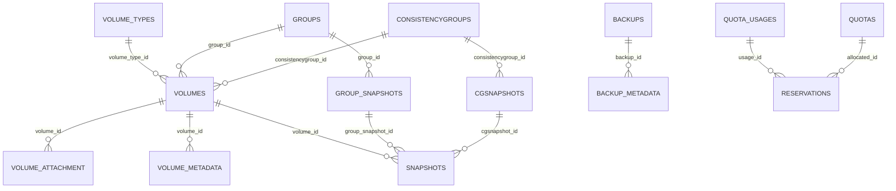

# 领域模型总览：全部 ORM 表与 OVO 归属

Cinder 的领域模型是双层结构：SQLAlchemy ORM 定义在 `cinder/db/sqlalchemy/models.py`，全部表继承 `BASE, CinderBase`；版本化对象（OVO）定义在 `cinder/objects/`，持久化对象继承 `cinder/objects/base.py:240` 的 `CinderPersistentObject`，注册经 `cinder/objects/base.py:140-154` 的 `CinderObjectRegistry` 挂到 `cinder.objects` 命名空间。卷聚合字段字典见 [`business/domain-models/volume.md`](volume.md)，备份 / 快照 / Group 聚合见 [`business/domain-models/backup.md`](backup.md)，存储层适配见 [`integrations/downstream/sqlalchemy-db.md`](../../integrations/downstream/sqlalchemy-db.md)。

## 1. 实体与存储关系图

- 关系全部来自 `cinder/db/sqlalchemy/models.py` 的 `relationship(...)` 与 `ForeignKey(...)`：`VolumeAttachment.volume_id` 在 `:346`、`VolumeMetadata.volume_id` 在 `:319`、`Snapshot.volume_id` 在 `:672`、`GroupSnapshot.group_id` 在 `:224`、`Cgsnapshot.consistencygroup_id` 在 `:204`、`BackupMetadata.backup_id` 在 `:765`、`Reservation.usage_id/allocated_id` 在 `:636-637`。
- `Volume.consistencygroup` 与 `Volume.group` 是两个独立 relationship（`:300-310`），分别用 `consistencygroup_id` 与 `group_id` 连接，旧 CG 与新 Group 并存。

## 2. 全部 ORM 表 → OVO 归属矩阵

> 表名与行号取自 `__tablename__` 字面量；「无独立 OVO」指 `cinder/objects/` 下没有同名持久化类，业务通过 DB API 或字典消费。

| ORM 表名（`cinder/db/sqlalchemy/models.py:行号`） | 对应 OVO / 归属 | 关键关联字段 |
|---|---|---|
| `services` (`:66`) | `Service` (`cinder/objects/service.py:28`) | `cluster_name`、`topic`、`disabled`、`frozen` |
| `clusters` (`:107`) | `Cluster` (`cinder/objects/cluster.py:28`) | `name` + `binary` + `race_preventer` 唯一约束（`:114`） |
| `consistencygroups` (`:161`) | `ConsistencyGroup` (`cinder/objects/consistencygroup.py:27`) | `volume_type_id`、`cgsnapshot_id`、`source_cgid` |
| `groups` (`:180`) | `Group` (`cinder/objects/group.py:28`) | `group_type_id`、`group_snapshot_id`、`source_group_id`、`replication_status` |
| `cgsnapshots` (`:201`) | `CGSnapshot` (`cinder/objects/cgsnapshot.py:24`) | `consistencygroup_id` |
| `group_snapshots` (`:221`) | `GroupSnapshot` (`cinder/objects/group_snapshot.py:24`) | `group_id`（nullable=False）、`group_type_id` |
| `volumes` (`:242`) | `Volume` (`cinder/objects/volume.py:52`) | `host`、`cluster_name`、`volume_type_id`、`group_id`、`migration_status` |
| `volume_metadata` (`:315`) | `Volume.metadata` 字典字段（`cinder/objects/volume.py:117`） | `volume_id` |
| `volume_admin_metadata` (`:329`) | `Volume.admin_metadata`（`cinder/objects/volume.py:118`） | `volume_id`；relation 加 `deleted == False` 条件（`:336-338`） |
| `volume_attachment` (`:343`) | `VolumeAttachment` (`cinder/objects/volume_attachment.py:28`) | `instance_uuid`、`mountpoint`、`attach_status`、`attach_mode` |
| `volume_types` (`:364`) | `VolumeType` (`cinder/objects/volume_type.py:29`) | `qos_specs_id`（外键到 quality_of_service_specs） |
| `group_types` (`:382`) | `GroupType` (`cinder/objects/group_type.py:25`) | 与 `volume_types` 分开管理 |
| `group_volume_type_mapping` (`:397`) | 无独立 OVO（Group 的 `volume_type_ids` 由关联表展开） | group ↔ volume type 多对多 |
| `volume_type_projects` (`:418`) | 无独立 OVO（类型可见性） | 项目维度访问约束 |
| `group_type_projects` (`:440`) | 无独立 OVO | 项目维度访问约束 |
| `volume_type_extra_specs` (`:461`) | `VolumeType.extra_specs`（`cinder/objects/volume.py:136` 预加载） | 类型能力键值 |
| `group_type_specs` (`:480`) | `GroupType` 的规格集合 | 组类型能力键值 |
| `quality_of_service_specs` (`:532`) | `QualityOfServiceSpecs` (`cinder/objects/qos_specs.py:28`) | 被 `volume_types.qos_specs_id` 引用 |
| `volume_glance_metadata` (`:558`) | `Volume.glance_metadata`（`cinder/objects/volume.py:119`） | 镜像启动卷的元数据 |
| `quotas` (`:581`) | 无独立 OVO（`DbQuotaDriver` 直接走 DB API） | `project_id` + `resource` + `hard_limit` + `allocated` |
| `quota_classes` (`:599`) | 无独立 OVO | `class_name` + `resource` |
| `quota_usages` (`:611`) | 无独立 OVO | `in_use` + `reserved`，`total` 属性在 `:622-624` |
| `reservations` (`:632`) | 无独立 OVO | `uuid`、`delta`、`expire`、`usage_id`、`allocated_id` |
| `snapshots` (`:658`) | `Snapshot` (`cinder/objects/snapshot.py:32`) | `volume_id`、`cgsnapshot_id`、`group_snapshot_id`、`progress` |
| `snapshot_metadata` (`:708`) | `Snapshot.metadata` 字典 | `snapshot_id` |
| `backups` (`:724`) | `Backup` (`cinder/objects/backup.py:33`) | `volume_id`、`snapshot_id`、`parent_id`、`status` |
| `backup_metadata` (`:761`) | `Backup.metadata`（`cinder/objects/backup.py:77`） | `backup_id` |
| `encryption` (`:780`) | 无独立 OVO（由 key manager 与卷类型共同消费） | 类型级 cipher / provider / key_size |
| `transfers` (`:799`) | 无独立 OVO | 卷所有权转移 |
| `driver_initiator_data` (`:815`) | 无独立 OVO | 驱动侧 initiator 数据 |
| `messages` (`:829`) | 无独立 OVO（由 `message_api.create` 写入） | 用户可见异步错误 |
| `image_volume_cache_entries` (`:850`) | 无独立 OVO | 镜像卷缓存 |
| `workers` (`:863`) | `CinderCleanableObject` 清理记录（`cinder/objects/cleanable.py:28`） | 由 OVO 清理机制写入 |
| `attachment_specs` (`:904`) | 无独立 OVO | 附件的 connector 规格 |

## 3. OVO 分层与枚举归属

- **基础层**：`CinderObject` (`cinder/objects/base.py:157`) 提供 `OBJ_PROJECT_NAMESPACE = 'cinder'`（`:161`）、`cinder_obj_get_changes()`（`:163-183`，把 tz-aware datetime 转成 naive UTC）；`CinderObjectDictCompat` (`:198`) 提供 `get()` 兼容字典访问；`CinderPersistentObject` (`:240`) 提供 `create/save/destroy` 持久化动作；`ClusteredObject` (`:475`) 提供集群字段行为。
- **请求对象（非持久化）**：`RequestSpec` (`cinder/objects/request_spec.py:22`) 与 `VolumeProperties` (`:91`) 承载调度入参，`RequestSpec.fields` 含 `group_backend` / `CG_backend` / `volume_type`（`:28-43`）；`obj_extra_fields = ['resource_properties']`（`:45`）兼容旧过滤器。
- **枚举层**：`BaseCinderEnum` (`cinder/objects/fields.py:26`) 是所有状态的基类；子枚举含 `BackupStatus` (`:31`)、`ConsistencyGroupStatus` (`:48`)、`GroupStatus` (`:65`)、`GroupSnapshotStatus` (`:83`)、`ReplicationStatus` (`:100`)、`SnapshotStatus` (`:119`)、`QoSConsumerValues` (`:139`)、`VolumeAttachStatus` (`:151`)。ROM 表 `status` 列本身是 `String(255)`（如 `cinder/db/sqlalchemy/models.py:268`、`:741`），枚举约束只在 OVO 层生效。
- **版本兼容**：`obj_make_compatible` 在多个 OVO 中裁剪新字段，例如 `Group` 对 `target_version < (1,1)` 剔除 `group_snapshot_id` / `source_group_id` / `group_snapshots`（`cinder/objects/group.py:60-69`）；跨版本 RPC 时必须保留这些分支。

## 4. 共变耦合与修改清单（全库读写归属与字段变更）

| 存储载体 | 权威写入方 | 读取消费方 | 并发机制 |
|---|---|---|---|
| `volumes` / `volume_attachment` | cinder-volume Manager 与 OVO `save()` | API 层 `conditional_update`、调度器 `volume_update_db` | 条件更新 CAS + 协调锁，见 [`business/volume-lifecycle.md`](../volume-lifecycle.md) |
| `quota_usages` / `reservations` | `cinder/db/sqlalchemy/api.py:1146` `quota_reserve` 的 `session.begin()` | `DbQuotaDriver.get_project_quotas` (`cinder/quota.py:171-245`) | 单事务 + 过期兜底，见 [`business/quotas.md`](../quotas.md) |
| `backups` / `backup_metadata` | cinder-backup Manager | API 查询与导入导出 | 状态守卫 + 父备份计数，见 [`business/domain-models/backup.md`](backup.md) |
| `groups` / `group_snapshots` | cinder-volume Manager 的 group 操作 | group API 与调度器 | `NotImplementedError` 双路径回退，见 [`business/groups-and-snapshots.md`](../groups-and-snapshots.md) |

- **字段增删改共变链**：ORM 列（`cinder/db/sqlalchemy/models.py:240-919`）→ OVO `fields` 字典（如 `cinder/objects/volume.py:69-127`）→ `VERSION` 与 `obj_make_compatible`（`cinder/objects/volume.py:63`、`:135-140`）→ DB API 转换 → 对外响应 DTO（见 [`contracts/api/v3-volumes.md`](../../contracts/api/v3-volumes.md)）→ 单测 fixture。
- **隐式陷阱**：`Volume.obj_extra_fields` (`cinder/objects/volume.py:131-132`) 声明了 `name` / `name_id` / `volume_metadata` 等别名，`CinderObject.__contains__` (`cinder/objects/base.py:190-195`) 会让这些别名通过 `in` 检查；新增同名字段前必须确认不是兼容别名。
