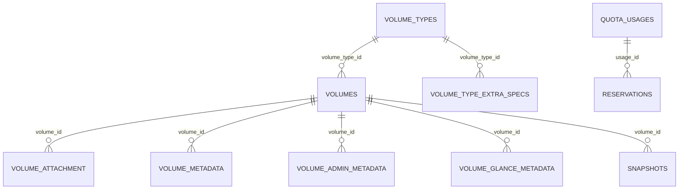

# Volume 聚合字段字典（volumes / attachment / metadata / type / quota）

Volume 聚合以 `volumes` 表为根，向外挂 `volume_attachment`、`volume_metadata`、`volume_admin_metadata`、`volume_glance_metadata` 与 `volume_type`；配额侧通过 `project_id` 与 `volume_type_id` 间接关联 `quota_usages` / `reservations`，不存在直接外键。权威 ORM 在 `cinder/db/sqlalchemy/models.py:240-373`，版本化对象在 `cinder/objects/volume.py:52`，OVO 当前 `VERSION = '1.6'`（`:63`）。主生命周期写路径见 [`business/volume-lifecycle.md`](../volume-lifecycle.md)，总览见 [`business/domain-models/index.md`](index.md)。

## 1. 实体与存储关系图

- `VolumeAttachment` 的 ORM relation 带 `deleted == False` 条件（`cinder/db/sqlalchemy/models.py:347-351`），`VolumeAdminMetadata` 同理（`:334-338`），软删行不会进入 OVO 列表。
- `Volume.volume_type` 在 OVO 中是可选的 `ObjectField('VolumeType')`（`cinder/objects/volume.py:120`），默认预期属性包含 `'volume_type'` 与 `'volume_type.extra_specs'`（`:136`）。

## 2. volumes 表与 OVO 精确字段字典

> 字段名、类型与默认值逐字取自 ORM `Column(...)` 与 OVO `fields` 字典。ORM `status` 为普通字符串列，枚举约束仅由 OVO 字段类型提供。

| 字段 | ORM 定义（`cinder/db/sqlalchemy/models.py`） | OVO 类型（`cinder/objects/volume.py`） | 约束 / 枚举 / 默认值 | 写入方锚点 |
|---|---|---|---|---|
| `id` | `Column(String(36), primary_key=True)` (`:243`) | `UUIDField()` (`:70`) | 主键，不可变 | `EntryCreateTask` 所在流 `cinder/volume/flows/api/create_volume.py:842` |
| `_name_id` | `Column(String(36))` (`:244`) | `UUIDField(nullable=True)` (`:71`) | 禁止直接访问；`name_id` property 在 `:142-148` 回退到 `id` | OVO property `:144` |
| `ec2_id` | `Column(Integer)` (`:258`) | `UUIDField(nullable=True)` (`:72`) | ORM 为 Integer，OVO 为 UUIDField（历史兼容差异） | 兼容路径 |
| `user_id` / `project_id` | `Column(String(255))` (`:259-260`) | `StringField(nullable=True)` (`:73-74`) | 租户边界；`project_id` 用于配额归属 | `cinder/volume/api.py:411-413` |
| `host` / `cluster_name` | `Column(String(255))` (`:264-265`) | `StringField(nullable=True)` (`:78`、`:81`) | 集群时 host 与 service 需匹配（`cinder/volume/manager.py:589-590`） | 调度器 `volume_update_db` |
| `size` | `Column(Integer)` (`:266`) | `IntegerField(nullable=True)` (`:82`) | 创建时 `int(size) > 0`；扩容仅允许增大 | `cinder/volume/manager.py:2555` |
| `availability_zone` | `Column(String(255))` (`:267`) | `StringField(nullable=True)` (`:83`) | 来自 `list_availability_zones` 集合 | `cinder/volume/api.py:299-302` |
| `status` | `Column(String(255))` (`:268`) | `StringField(nullable=True)` (`:84`) | 字面量由业务守卫约束，非 OVO 枚举 | `cinder/volume/api.py:459` |
| `attach_status` | `Column(String(255))` (`:269`) | `c_fields.VolumeAttachStatusField(nullable=True)` (`:85`) | `attached`/`attaching`/`detached`/`reserved`/`error_attaching`/`error_detaching`/`deleted`，见 `cinder/objects/fields.py:151-161` | `cinder/volume/api.py:434` |
| `migration_status` | `Column(String(255))` (`:270`) | `StringField(nullable=True)` (`:86`) | `starting`/`migrating`/`success`/`error`/`target:<id>` | `cinder/volume/manager.py:2303`、`:2027` |
| `scheduled_at` / `launched_at` / `terminated_at` | `Column(DateTime)` (`:272-274`) | `DateTimeField(nullable=True)` (`:88-90`) | 重调度时 `scheduled_at` 刷新且 `host` 置空，见 `cinder/volume/flows/manager/create_volume.py:116-123` | 调度器 / 管理器 |
| `display_name` / `display_description` | `Column(String(255))` (`:276-277`) | `StringField(nullable=True)` (`:92-93`) | 用户可见名称 | `cinder/volume/api.py:309-310` |
| `provider_id` / `provider_location` / `provider_auth` / `provider_geometry` | `Column(String(255))` (`:279-282`) | `StringField(nullable=True)` (`:95-98`) | 驱动私有位置与认证信息 | 驱动 `model_update` |
| `volume_type_id` | `Column(String(36))` (`:284`) | `UUIDField(nullable=True)` (`:100`) | 同时决定类型配额键 | `cinder/volume/api.py:1573-1574` |
| `source_volid` | `Column(String(36))` (`:285`) | `UUIDField(nullable=True)` (`:101`) | 创建流用于加删除锁 | `cinder/volume/manager.py:627-629` |
| `encryption_key_id` | `Column(String(36))` (`:286`) | `UUIDField(nullable=True)` (`:102`) | 非空时删除会调用 `key_manager.delete` | `cinder/volume/api.py:503-506` |
| `consistencygroup_id` / `group_id` | `Column(String(36))` (`:288-289`) | `UUIDField(nullable=True)` (`:104-105`) | 两个独立 relationship（`:300-310`） | Group / CG 流程 |
| `bootable` / `multiattach` | `Column(Boolean, default=False)` (`:291-292`) | `BooleanField(default=False, nullable=True)` (`:108-109`) | 默认 False | 创建流 |
| `replication_status` / `_extended_status` / `_driver_data` | `Column(String(255))` (`:294-296`) | `StringField(nullable=True)` (`:111-113`) | 枚举见 `ReplicationStatus` (`cinder/objects/fields.py:100-112`) | 驱动上报 |
| `previous_status` | `Column(String(255))` (`:298`) | `StringField(nullable=True)` (`:115`) | 用于 retype / extend / upload 失败复位 | `cinder/volume/api.py:1309` |
| `deleted` | `CinderBase` 公共列 | `BooleanField(default=False, nullable=True)` (`:107`) | 软删标记 | OVO `destroy()` |
| `metadata` / `admin_metadata` / `glance_metadata` | 三张独立表 | `DictOfStringsField(nullable=True)` (`:117-119`) | OPTIONAL_FIELDS（`:65-67`），按需加载 | DB API |
| `volume_type` / `volume_attachment` / `consistencygroup` / `snapshots` / `group` / `cluster` | 关联表 | `ObjectField(...)` (`:120-126`) | 均 nullable；`cluster` 另带 `read_only=True`（`:79-80`） | OVO lazy load |

## 3. attachment / metadata / type / quota 字段字典与 Writer-Reader 归属

| 存储载体 | 精确表名或字段路径 | 权威写入方（Writers） | 读取消费方（Readers） | 并发与原子性 |
|---|---|---|---|---|
| `volume_attachment` | `cinder/db/sqlalchemy/models.py:343-359`：列 `id`/`volume_id`/`instance_uuid`/`attached_host`/`mountpoint`/`attach_time`/`detach_time`/`attach_status`/`attach_mode`/`connection_info`（`Text`）；OVO 见 `cinder/objects/volume_attachment.py:39-54` | cinder-volume `attach_volume` / `detach_volume`，见 `cinder/volume/manager.py:1130-1317` | `cinder/volume/api.py:728-766`、迁移完成 `cinder/volume/api.py:1504-1512` | `attach_status` 走 OVO 枚举字段，`connection_info` 以 JSON 字符串落库并在 `cinder/objects/volume_attachment.py:88-90` 反序列化 |
| `volume_metadata` | `key`/`value`/`volume_id` (`cinder/db/sqlalchemy/models.py:315-319`) | `update_volume_admin_metadata` 写 admin 侧，用户 metadata 走卷创建 `cinder/volume/api.py:304` | OVO `Volume.metadata` (`cinder/objects/volume.py:117`) | 外键 `volume_id` NOT NULL |
| `volume_admin_metadata` | `key`/`value`/`volume_id` (`:329-333`) | `cinder/volume/api.py:737-740` 补写 `readonly='False'` | `cinder/volume/api.py:741` 判定只读挂载 | relation 附加 `deleted == False`（`:336-338`） |
| `volume_glance_metadata` | 表定义 `cinder/db/sqlalchemy/models.py:558` | 镜像启动卷创建时写入 | OVO `glance_metadata`（`cinder/objects/volume.py:119`）；快照复制见 `cinder/volume/manager.py:1031-1032` | 复制失败抛 `MetadataCopyFailure` |
| `volume_types` | `id`/`name`/`description`/`qos_specs_id`/`is_public` (`cinder/db/sqlalchemy/models.py:364-371`) | 类型管理 API | OVO `VolumeType` (`cinder/objects/volume_type.py:39-49`)；预加载 `extra_specs` (`cinder/objects/volume.py:136`) | `is_public` 默认 True |
| `volume_type_extra_specs` | `key`/`value` (`cinder/db/sqlalchemy/models.py:461`) | 类型管理 | `VolumeType.extra_specs` 为 `DictOfNullableStringsField` (`cinder/objects/volume_type.py:45`)，转换见 `:84-91` | `target_version < (1,1)` 时 None 转空串（`:55-62`） |
| `quotas` | `project_id`/`resource`/`hard_limit`/`allocated` (`cinder/db/sqlalchemy/models.py:581-588`) | 配额管理 API | `DbQuotaDriver.get_project_quotas` (`cinder/quota.py:171-245`) | `hard_limit` 为 NULL 表示无限 |
| `quota_usages` | `project_id`/`resource`/`in_use`/`reserved`/`until_refresh` (`cinder/db/sqlalchemy/models.py:611-626`)；`total = in_use + reserved` (`:622-624`) | `quota_reserve` (`cinder/db/sqlalchemy/api.py:1146-1247`) | `quota_reserve` 与项目配额查询 | 事务内刷新与判定 |
| `reservations` | `uuid`/`usage_id`/`allocated_id`/`project_id`/`resource`/`delta`/`expire` (`cinder/db/sqlalchemy/models.py:632-643`) | `DbQuotaDriver.reserve` (`cinder/quota.py:331-398`) | `commit` (`:400-414`) 与 `rollback` (`:416`) | 过期时间由 `CONF.reservation_expire` 决定 |
| 类型配额键 | 每类型三键 `volumes_<type>` / `gigabytes_<type>` / `snapshots_<type>`，由 `VolumeTypeQuotaEngine.resources` (`cinder/quota.py:1147-1153`) 生成 | 配额引擎 | `add_volume_type_opts` (`cinder/quota.py:1093`) | 改名走 `update_quota_resource` (`:1162-1184`) |

## 4. 共变耦合与修改清单（字段增删改 Schema Change Playbook）

- **新增或重命名字段必查链**：
  1. ORM 列：`cinder/db/sqlalchemy/models.py:240-373`（以及对应 metadata 表 `:313-338`）。
  2. OVO `fields` 字典与 `VERSION`：`cinder/objects/volume.py:63`、`:69-127`；`VolumeAttachment` 在 `cinder/objects/volume_attachment.py:34`、`:39-54`；`VolumeType` 在 `cinder/objects/volume_type.py:35`、`:39-49`。
  3. 版本兼容裁剪：`obj_make_compatible`，例如 `VolumeAttachment` 对 `target_version < (1,2)` 剔除 `connection_info`（`cinder/objects/volume_attachment.py:68-74`）、`VolumeType` 对 `< (1,3)` 剔除 `qos_specs_id`（`cinder/objects/volume_type.py:63-64`）。
  4. 预加载与别名：`Volume._get_expected_attrs` (`cinder/objects/volume.py:134-140`)、`obj_extra_fields` (`:131-132`)、`VolumeAttachment.project_id/volume_host` property (`cinder/objects/volume_attachment.py:56-62`)。
  5. 状态枚举同步：`cinder/objects/fields.py:100-112`、`:151-161`；对外 DTO 见 [`contracts/api/v3-volumes.md`](../../contracts/api/v3-volumes.md)。
  6. 配额键与用量：类型相关字段变更须同步 [`business/quotas.md`](../quotas.md) 的 `VolumeTypeQuotaEngine.resources`。
- **隐式陷阱 1**：`ec2_id` 在 ORM 是 `Integer`（`cinder/db/sqlalchemy/models.py:258`）而在 OVO 是 `UUIDField`（`cinder/objects/volume.py:72`）；读写该字段前必须确认来源层，禁止按同一类型处理。
- **隐式陷阱 2**：`VolumeAttachment.connection_info` 在 ORM 是 `Text`，在 OVO 是 `DictOfNullableField`（`cinder/objects/volume_attachment.py:53`），反序列化发生在 `:88-90`；直接把 OVO 字典写回 DB 会生成错误字符串。
- **隐式陷阱 3**：`name` 不是数据库列，而是用 `CONF.volume_name_template % name_id` 计算（`cinder/db/sqlalchemy/models.py:254-256`、`cinder/objects/volume.py:150-152`）；修改命名模板会影响所有卷的对外名称但不产生迁移。
