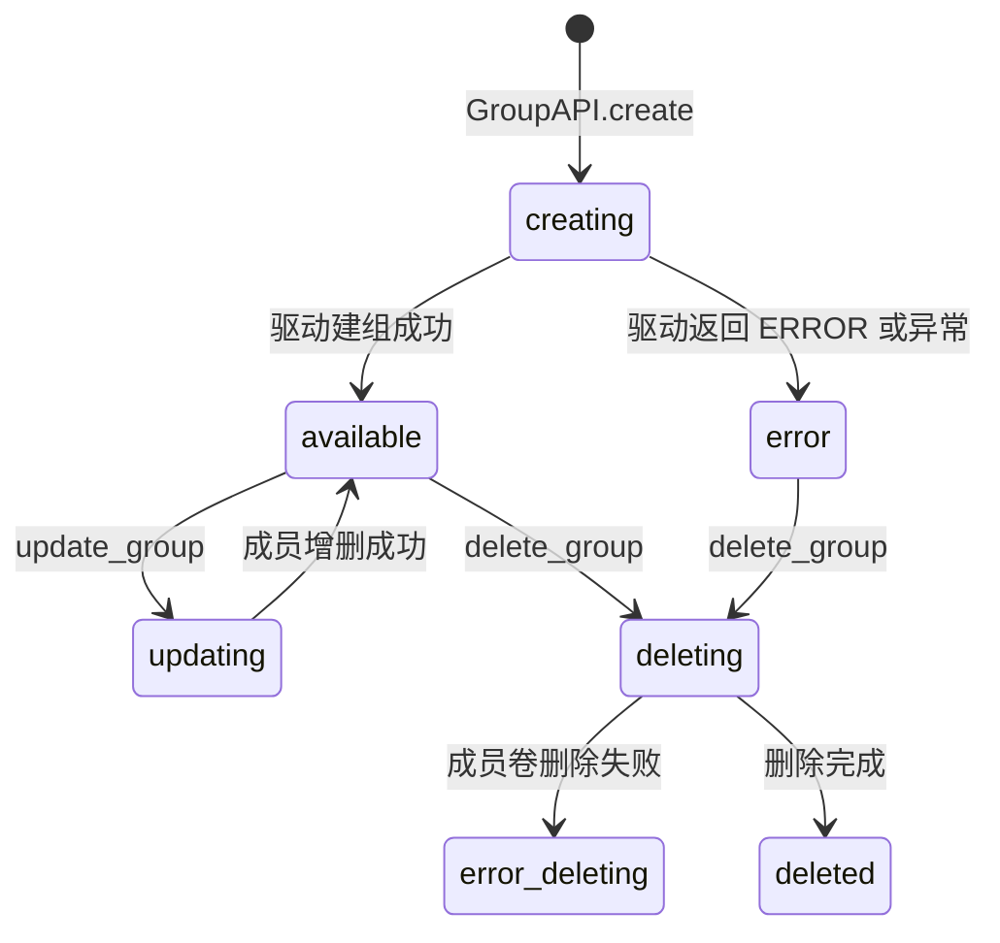

# WF-05 · Group / CG 与快照 / 一致性快照

Group 是跨多卷的逻辑容器，一致性快照通过把成员卷的 `group_snapshot_id` / `cgsnapshot_id` 绑定到同一快照集合实现时间点一致性。管理器对 `driver.create_group` 等抛出 `NotImplementedError` 的驱动提供两条回退：泛型实现 `_create_group_generic` 与老 CG 路径 `create_consistencygroup`；状态枚举分别落在 `GroupStatus` / `GroupSnapshotStatus` / `SnapshotStatus` / `ConsistencyGroupStatus`。卷级快照见 [`business/volume-lifecycle.md`](../business/volume-lifecycle.md)，备份对快照的消费见 [`business/backup-restore.md`](../business/backup-restore.md)，字段字典见 [`business/domain-models/backup.md`](../business/domain-models/backup.md)。

## 1. 符号级端到端执行调用树

```text
Trigger: POST /v3/{project_id}/groups -> cinder/group/api.py:131 GroupAPI.create
  ├─ cinder/group/api.py:133 check_policy(context, 'create')
  ├─ cinder/group/api.py:137 volume_types_get_by_name_or_id(context.elevated(), volume_types)
  ├─ cinder/group/api.py:140-144 group_type 按 uuidutils.is_uuid_like 分派到 group_type_get / group_type_get_by_name
  ├─ cinder/group/api.py:146 _extract_availability_zone -> :107-127 缺失时用 default_availability_zone 或 storage_availability_zone；不在可用集合且 allow_availability_zone_fallback=False -> InvalidInput
  ├─ cinder/group/api.py:150-155 kwargs: status=GroupStatus.CREATING、replication_status=ReplicationStatus.DISABLED
  ├─ cinder/group/api.py:157-162 GROUP_QUOTAS.reserve(groups=1)，OverQuota -> process_reserve_over_quota(resource='groups')
  ├─ cinder/group/api.py:165-171 objects.Group(**kwargs).create()，异常 -> GROUP_QUOTAS.rollback
  └─ cinder/group/api.py:173-184 构造 request_spec_list / group_spec -> 调度器 create_group
       └─ cinder/volume/manager.py:2863 Manager.create_group
            ├─ :2870 status = GroupStatus.AVAILABLE；:2876 require_driver_initialized
            ├─ :2881 driver.create_group；:2882 NotImplementedError 时
            │    ├─ :2884 group_type_id != default_cgsnapshot_type['id'] -> :2885 _create_group_generic
            │    └─ :2887 _convert_group_to_cg -> :2888 driver.create_consistencygroup
            ├─ :2892 model_update['status'] == GroupStatus.ERROR -> VolumeDriverException
            └─ :2902-2911 异常置 GroupStatus.ERROR；成功置 AVAILABLE 并写 created_at

Trigger: 从源创建 Group
  cinder/volume/manager.py:2921 Manager.create_group_from_src(context, group, group_snapshot=None, source_group=None)
    ├─ :2936 GroupSnapshot.get_by_id 不存在 -> GroupSnapshotNotFound 直接上抛
    ├─ :2947 SnapshotList.get_all_for_group_snapshot(context, group_snapshot.id)
    └─ :2950-2959 snap.status not in VALID_CREATE_GROUP_SRC_SNAP_STATUS -> InvalidGroup

Trigger: Group 生命周期
  cinder/volume/manager.py:3254 delete_group
    ├─ :3264 VolumeList.get_all_by_generic_group；:3268 vol_obj.attach_status == "attached" -> VolumeAttached
    ├─ :3282 driver.delete_group；NotImplementedError 时 :3287 _delete_group_generic 或 :3293 delete_consistencygroup
    ├─ :3301 update['status'] in ['error_deleting','error'] 且 group 非错 -> 把 group model_update['status'] 置为子卷状态
    └─ :3318-3328 异常时 group.status=GroupStatus.ERROR；无 volumes_model_update 时把所有成员卷置 'error'
  cinder/volume/manager.py:3497 update_group(add_volumes, remove_volumes)
    ├─ :3505-3512 _collect_volumes_for_group(add=True/False)
    ├─ :3521 driver.update_group；NotImplementedError 时 :3529 _update_group_generic 或 :3537 update_consistencygroup
    └─ :3551-3557 model_update['status'] in [GroupStatus.ERROR] -> VolumeDriverException

Trigger: 一致性快照
  POST /v3/{project_id}/group_snapshots -> cinder/volume/manager.py:3597 Manager.create_group_snapshot
    ├─ :3604 SnapshotList.get_all_for_group_snapshot
    ├─ :3625 driver.create_group_snapshot(context, group_snapshot, snapshots)
    ├─ :3628 NotImplementedError 时 :3632 _create_group_snapshot_generic 或 :3639 create_cgsnapshot
    ├─ :3647-3657 逐 snapshot 写 model_update；子快照 ERROR_DELETING/ERROR 且组快照未错 -> 上提升到 model_update['status']
    ├─ :3660 model_update['status'] == GroupSnapshotStatus.ERROR -> VolumeDriverException
    └─ :3669-3679 CinderException 时组快照置 ERROR；无 snapshots_model_update 时所有子快照置 SnapshotStatus.ERROR
  cinder/volume/manager.py:3763 delete_group_snapshot: :3793 driver.delete_group_snapshot / :3799 _delete_group_snapshot_generic / :3806 delete_cgsnapshot
  cinder/volume/api.py:1013 create_snapshot -> manager.py:1001 create_snapshot: :1018 driver.create_snapshot，:1028-1046 bootable 卷复制 glance metadata，:1048-1050 status=AVAILABLE 且 progress='100%'
  cinder/volume/api.py:1034 delete_snapshot: :1040 expected cgsnapshot_id/group_snapshot_id 均为 None；非 force 时 status in (AVAILABLE, ERROR)
```

## 2. 分阶段业务规则与精确判定表

| 阶段 | 负责函数（`路径:行号`） | 精确布尔条件 / 阈值常量 | 命中分支行为 | 状态或数据副作用 |
|---|---|---|---|---|
| AZ 缺省 | `GroupAPI._extract_availability_zone` (`cinder/group/api.py:107-113`) | `availability_zone is None` 且 `CONF.default_availability_zone` 非空 → 取它；否则 `CONF.storage_availability_zone` | 确定组所属可用区 | 写入 group.availability_zone |
| AZ 回退 | `GroupAPI._extract_availability_zone` (`cinder/group/api.py:114-127`) | `availability_zone not in availability_zones` 且 `CONF.allow_availability_zone_fallback` → 回退；否则 `InvalidInput` | 回退时 `LOG.warning`，拒绝时抛异常 | 不创建组 |
| 组配额 | `GroupAPI.create` (`cinder/group/api.py:157-171`) | `GROUP_QUOTAS.reserve(groups=1)` 抛 `OverQuota` | `process_reserve_over_quota(resource='groups')`；建组失败则 `GROUP_QUOTAS.rollback` | `groups` 用量计数 |
| 驱动能力分派 | `Manager.create_group` (`cinder/volume/manager.py:2882-2889`) | `NotImplementedError` 且 `group.group_type_id != cgsnap_type['id']` → 泛型；否则走 CG | 选择兼容路径 | 写入 `model_update` |
| 驱动错误上抛 | `Manager.create_group` (`cinder/volume/manager.py:2892-2898`) | `model_update['status'] == GroupStatus.ERROR` | 抛 `VolumeDriverException("Create group failed.")` | 组置 ERROR |
| 源快照状态 | `Manager.create_group_from_src` (`cinder/volume/manager.py:2950-2959`) | `snap.status not in VALID_CREATE_GROUP_SRC_SNAP_STATUS` | 抛 `InvalidGroup`，合法状态集合写入日志 | 不创建组 |
| 删除前置 | `Manager.delete_group` (`cinder/volume/manager.py:3267-3271`) | 任一成员 `vol_obj.attach_status == "attached"` | 抛 `VolumeAttached(volume_id=vol_obj.id)` | 组删除中止 |
| 删除错误传播 | `Manager.delete_group` (`cinder/volume/manager.py:3301-3304`) | `update['status'] in ['error_deleting','error']` 且 `model_update['status'] not in ['error_deleting','error']` | 子卷错误状态上提到组 | 组 status 同步错误 |
| 更新错误 | `Manager.update_group` (`cinder/volume/manager.py:3551-3557`) | `model_update['status'] in [GroupStatus.ERROR]` | 抛 `VolumeDriverException` | 不保存 model_update |
| 快照错误上提 | `Manager.create_group_snapshot` (`cinder/volume/manager.py:3651-3657`) | `snap_model['status'] in [SnapshotStatus.ERROR_DELETING, SnapshotStatus.ERROR]` 且 `model_update['status'] not in [GroupSnapshotStatus.ERROR_DELETING, GroupSnapshotStatus.ERROR]` | 把子快照错误写入 `model_update['status']` | 组快照随子卷失败 |
| 快照异常兜底 | `Manager.create_group_snapshot` (`cinder/volume/manager.py:3671-3679`) | `except exception.CinderException` 且 `not snapshots_model_update` | 组快照置 ERROR，所有子快照置 `SnapshotStatus.ERROR` | 全部失败可见 |
| 快照删除分派 | `Manager.delete_group_snapshot` (`cinder/volume/manager.py:3795-3808`) | `NotImplementedError` 且 `group_type_id != cgsnap_type['id']` → `_delete_group_snapshot_generic`；否则 `delete_cgsnapshot` | 选择兼容路径 | 子快照 `cgsnapshot_id` 被清理 |
| 单快照删除守卫 | `VolumeAPI.delete_snapshot` (`cinder/volume/api.py:1040-1049`) | `expected = {'cgsnapshot_id': None, 'group_snapshot_id': None}`；非 force 时 `status in (AVAILABLE, ERROR)`；unmanage_only → `UNMANAGING` | 不满足即 `InvalidSnapshot` | 普通删除置 `DELETING` |
| 单快照完成 | `Manager.create_snapshot` (`cinder/volume/manager.py:1018-1050`) | `model_update` 非空时写回；`vol_ref.bootable` 时复制 glance metadata；异常置 `ERROR` | 成功 `status=AVAILABLE`、`progress='100%'` | `snapshots` 行与 provider 信息 |

## 3. 实体状态机与合法迁移约束



- **枚举权威来源**：`GroupStatus` 字面量为 `error` / `available` / `creating` / `deleting` / `deleted` / `updating` / `in-use` / `error_deleting`（`cinder/objects/fields.py:65-76`）；`GroupSnapshotStatus` 为 `error` / `available` / `creating` / `deleting` / `deleted` / `updating` / `error_deleting`（`cinder/objects/fields.py:83-93`）；`ConsistencyGroupStatus` 为 `error` / `available` / `creating` / `deleting` / `deleted` / `updating` / `error_deleting`（`cinder/objects/fields.py:48-58`）。CG 比 Group 少 `in-use`。
- **快照枚举**：`SnapshotStatus` 含 `backing-up`、`restoring`、`unmanaging` 等字面量，`cinder/objects/fields.py:119-132`；一致性快照的子快照状态只能取其中值，禁止写 `GroupStatus` 的值到快照。
- **不可违反的不变量 1**：成员卷只要 `attach_status == 'attached'` 就禁止删组（`cinder/volume/manager.py:3268-3270`），该检查在驱动调用之前，先于 `require_driver_initialized`（`:3279`）。
- **不可违反的不变量 2**：子快照/子卷的错误状态必须上提到组级 `model_update['status']`（`cinder/volume/manager.py:3301-3304`、`:3651-3657`），否则组会错误地显示 `available` 而成员已损坏。
- **不可违反的不变量 3**：独立删除单张快照的守卫恒要求 `cgsnapshot_id` 与 `group_snapshot_id` 同时为 `None`（`cinder/volume/api.py:1040-1041`）；属于一致性快照的成员只能随组快照整体删除。
- **不可违反的不变量 4**：`create_group_from_src` 在组快照分支必须重新 `GroupSnapshot.get_by_id` 验证存在性（`cinder/volume/manager.py:2936-2944`），防止快照在提交后被删。

## 4. 幂等、并发互斥与异常补偿回滚表

| 边界 / 故障场景 | 源码检测条件（`路径:行号`） | 保护 / 回滚 / 降级动作 |
|---|---|---|
| 建组配额已占但落库失败 | `GroupAPI.create` (`cinder/group/api.py:164-171`) | `except Exception` 中 `GROUP_QUOTAS.rollback(context, reservations)` 后重抛 |
| 组快照源在提交前被删 | `Manager.create_group_from_src` (`cinder/volume/manager.py:2936-2944`) | 捕获 `GroupSnapshotNotFound`，记错误日志后重抛，不创建半组 |
| 驱动不支持 Group API | `Manager.create_group` (`:2882`)、`delete_group` (`:3284`)、`update_group` (`:3525`)、`create_group_snapshot` (`:3628`)、`delete_group_snapshot` (`:3795`) | 统一 `except NotImplementedError`，按 group type 是否为默认 cgsnapshot type 选择泛型路径或 CG 兼容路径 |
| 驱动未返回子对象更新 | `Manager.create_group` (`:2902-2907`)、`create_group_snapshot` (`:3673-3679`)、`delete_group` (`:3322-3328`) | 显式把组 / 组快照置 ERROR、成员置 ERROR，使失败可观测 |
| 成员卷状态漂移 | `Manager.delete_group` (`:3267-3271`) | 逐卷校验 attach_status 与 `_check_is_our_resource`，任一失败整组拒绝 |
| bootable 卷快照元数据丢失 | `Manager.create_snapshot` (`:1031-1046`) | `GlanceMetadataNotFound` 跳过；其它 `CinderException` 置快照 ERROR 并抛 `MetadataCopyFailure` |
| 旧 CG 残留 ID | `Manager.delete_group` (`:3295`)、`delete_group_snapshot` (`:3808`) | `_remove_consistencygroup_id_from_volumes` / `_remove_cgsnapshot_id_from_snapshots` 清理字段，防止后续删除再被守卫拦截 |

## 5. 共变耦合与修改清单（Agent Co-Change Playbook）

- **修改本流程业务规则时必查联动点**：
  1. API 入口与 AZ 回退：`cinder/group/api.py:101-184`；组配额 `GROUP_QUOTAS` 定义于 `cinder/quota.py:1211-1224`、`:1236`，语义见 [`business/quotas.md`](../business/quotas.md)。
  2. 管理器五组操作：`cinder/volume/manager.py:2863`、`:2921`、`:3254`、`:3497`、`:3597`、`:3763`，均含 `NotImplementedError` 双分支；契约见 [`contracts/api/v3-other.md`](../contracts/api/v3-other.md)。
  3. 状态枚举与 OVO 字段：`cinder/objects/fields.py:48-93`、`119-132`；`Group` 字段在 `cinder/objects/group.py:38-58`，`GroupSnapshot` 在 `cinder/objects/group_snapshot.py:30-41`。
  4. ORM 表：`consistencygroups` / `groups` / `cgsnapshots` / `group_snapshots` / `snapshots` 定义于 `cinder/db/sqlalchemy/models.py:159-237`、`:656-703`，归属见 [`business/domain-models/index.md`](../business/domain-models/index.md) 与 [`business/domain-models/backup.md`](../business/domain-models/backup.md)。
  5. 单卷快照与备份交叉：`cinder/volume/api.py:1013`、`:1034`，一致性快照可被备份引用为 `snapshot_id`，见 [`business/backup-restore.md`](../business/backup-restore.md)。
  6. 卷生命周期不可变式：成员卷的 `attach_status` 来自 `cinder/objects/fields.py:151-161`，级联删除顺序见 [`business/volume-lifecycle.md`](../business/volume-lifecycle.md)。
- **隐式陷阱**：`GroupSnapshot` 的 `host` 与 `cluster_name` 是只读 property，代理自 `self.group`（`cinder/objects/group_snapshot.py:43-49`），并非数据库列；`groups` 表有 `replication_status` 列（`cinder/db/sqlalchemy/models.py:196`）但 `group_snapshots` 没有，新增字段必须先区分 ORM 列与 OVO 计算属性。
