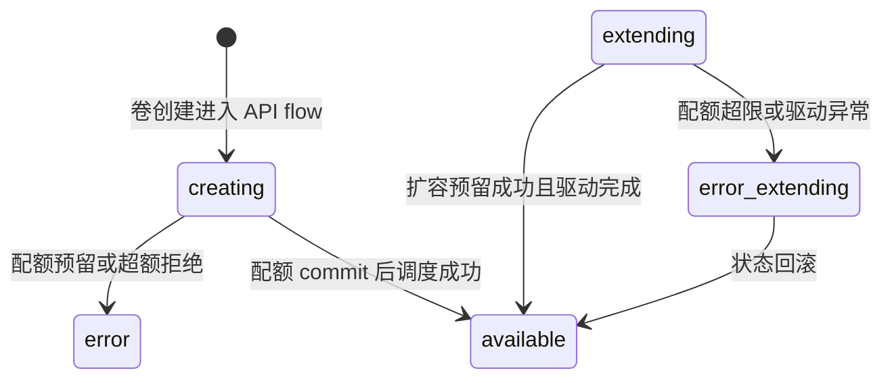

# WF-04 · 配额预留 / 提交 / 回滚 / 超额拒绝

配额采用「预留 → 提交 / 回滚」三阶段协议：`reserve` 在数据库事务内检查并写入 `reservations` 行，成功返回 UUID 列表；`commit` 把预留转成 `in_use`；`rollback` 释放预留。所有超额判定集中在 `DbQuotaDriver` 与 `db.quota_reserve`，卷创建流通过 Taskflow 的 `revert` 保证失败不残留占额。字段与表归属见 [`business/domain-models/index.md`](../business/domain-models/index.md)，调用方见 [`business/volume-lifecycle.md`](../business/volume-lifecycle.md)，扩容调度失败回滚见 [`business/scheduling.md`](../business/scheduling.md)。

## 1. 符号级端到端执行调用树

```text
入口一（卷创建流）:
  cinder/volume/flows/api/create_volume.py:818 get_flow -> :841 api_flow.add(QuotaReserveTask(), EntryCreateTask(), QuotaCommitTask())
    ├─ cinder/volume/flows/api/create_volume.py:619 QuotaReserveTask.execute
    │    ├─ :621 values = {'per_volume_gigabytes': size}
    │    ├─ :622 QUOTAS.limit_check(...) -> cinder/quota.py:962 QuotaEngine.limit_check -> :987 _driver.limit_check
    │    │    └─ cinder/quota.py:311 unders = [key for key,val in values.items() if val < 0] -> InvalidQuotaValue
    │    │       cinder/quota.py:325 overs = [key for key,val in values.items() if quotas[key] >= 0 and quotas[key] < val] -> OverQuota
    │    ├─ :630 reserve_opts = {'volumes': 1, 'gigabytes': size}
    │    ├─ :631 QUOTAS.add_volume_type_opts(context, reserve_opts, volume_type_id) -> cinder/quota.py:1093
    │    └─ :632 QUOTAS.reserve(context, **reserve_opts) -> cinder/quota.py:990 -> :1025 _driver.reserve
    │         └─ cinder/quota.py:331 DbQuotaDriver.reserve -> :396 db.quota_reserve(..., CONF.until_refresh, CONF.max_age, project_id)
    │              └─ cinder/db/sqlalchemy/api.py:1146 quota_reserve -> :1162-1228 用量刷新 -> :1230 unders -> :1245 overs -> :1257 写 reservations
    └─ cinder/volume/flows/api/create_volume.py:680 QuotaCommitTask.execute -> QUOTAS.commit(context, reservations)
         ├─ :684 optional_args['is_quota_committed'] = True
         └─ cinder/volume/flows/api/create_volume.py:687 QuotaCommitTask.revert: 重新 reserve({'volumes':-1,'gigabytes':-size}) 并 commit

入口二（失败回滚）:
  cinder/volume/flows/api/create_volume.py:641 QuotaReserveTask.revert
    ├─ :643 if isinstance(result, ft.Failure) -> return
    ├─ :646 if optional_args['is_quota_committed'] -> return（已提交不可回滚）
    └─ :654 QUOTAS.rollback(context, reservations) -> cinder/quota.py:1053 QuotaEngine.rollback -> :1065 _driver.rollback

入口三（类型相关预留）:
  cinder/quota_utils.py:49 get_volume_type_reservation(ctxt, volume, type_id, reserve_vol_type_only=False)
    ├─ :55 reserve_opts = {'volumes': 1, 'gigabytes': volume['size']}
    ├─ :56 QUOTAS.add_volume_type_opts -> 追加 "volumes_<type>" / "gigabytes_<type>" / "snapshots_<type>"
    ├─ :61-63 reserve_vol_type_only=True 时 pop('volumes') 与 pop('gigabytes')
    └─ :72-75 except OverQuota -> process_reserve_over_quota(context, e, resource='volumes', size=volume.size)

入口四（扩容 + 备份 + 删除的负向预留）:
  cinder/volume/api.py:1356 _extend: reserve({'gigabytes': size_increase}) -> cinder/volume/manager.py:2544 rollback / :2547 commit
  cinder/backup/api.py:242 create: reserve({'backups': 1, 'backup_gigabytes': size})
  cinder/backup/manager.py:574 delete_backup: reserve({'backups': -1, 'backup_gigabytes': -size}) -> :596 commit
  cinder/volume/api.py:407 API.delete: reserve({'volumes': -1, 'gigabytes': -size}) -> :420 commit
```

## 2. 分阶段业务规则与精确判定表

> Agent 必读：阈值与比较符逐字取自源码；`>= 0` 表示 -1 为「无限配额」。

| 阶段 | 负责函数（`路径:行号`） | 精确布尔条件 / 阈值常量 | 命中分支行为 | 状态或数据副作用 |
|---|---|---|---|---|
| 简单限额负值 | `DbQuotaDriver.limit_check` (`cinder/quota.py:311-314`) | `unders = [key for key,val in values.items() if val < 0]` | 非空即 `InvalidQuotaValue(unders=sorted(unders))` | 不查询 DB |
| 简单限额超额 | `DbQuotaDriver.limit_check` (`cinder/quota.py:320-329`) | `overs = [key for key,val in values.items() if quotas[key] >= 0 and quotas[key] < val]` | 非空即 `OverQuota(overs=sorted(overs), quotas=quotas, usages={})` | 不预留 |
| 预留过期计算 | `DbQuotaDriver.reserve` (`cinder/quota.py:367-375`) | `expire is None` → `CONF.reservation_expire`；`isinstance(expire, int)` → `timedelta(seconds=expire)`；非 datetime → `InvalidReservationExpiration` | 以绝对时间写入 reservation | 过期预留由后台清理 |
| 资源类型过滤 | `DbQuotaDriver._get_quotas` (`cinder/quota.py:265-277`) | `has_sync` 决定 `hasattr(x,'sync')` 或 `not hasattr(x,'sync')`；`len(keys) != len(sub_resources)` | 不等即 `QuotaResourceUnknown(unknown=sorted(...))` | 不返回配额 |
| 用量刷新触发 | `quota_reserve` (`cinder/db/sqlalchemy/api.py:1167-1188`) | 资源不在 `usages`；`in_use < 0`；`until_refresh` 递减后 `<= 0`；`max_age and updated_at` 且 `now - updated_at >= max_age` | 任一成立即调 `QUOTA_SYNC_FUNCTIONS[resources[resource].sync]` 重算 | `usages[res].in_use` 被覆盖 |
| 负向预留下界 | `quota_reserve` (`cinder/db/sqlalchemy/api.py:1230-1236`) | `is_allocated_reserve` 时 `delta < 0 and delta + allocated.get(r,0) < 0`；否则 `delta < 0 and delta + usages[r].in_use < 0` | 归入 `unders` | 防止释放超过实际占用 |
| 超额判定 | `quota_reserve` (`cinder/db/sqlalchemy/api.py:1245-1247`) | `quotas[r] >= 0 and delta >= 0 and quotas[r] < delta + usages[r].total + allocated.get(r,0)`；`QuotaUsage.total = in_use + reserved`（`models.py:622-624`） | 归入 `overs`，事务内不抛，事务后抛 `OverQuota` | 用量更新保留，预留不创建 |
| 预留落库 | `quota_reserve` (`cinder/db/sqlalchemy/api.py:1257-1275`) | `if not overs` | 逐资源创建 `Reservation`；`is_allocated_reserve` 时直接 `quota_allocated_update` 且 `usage = None` | 返回 `reservations` UUID 列表 |
| 单卷上限 | `API._extend` (`cinder/volume/api.py:1339-1346`) | `QUOTAS.limit_check(per_volume_gigabytes=new_size)` 抛 `OverQuota` | 转抛 `VolumeSizeExceedsLimit(size=new_size, limit=quotas['per_volume_gigabytes'])` | 状态回滚 |
| 扩容总量 | `API._extend` (`cinder/volume/api.py:1362-1375`) | `OverQuota` 时 `consumed = gigabytes['reserved'] + gigabytes['in_use']` | 抛 `VolumeSizeExceedsAvailableQuota(requested, consumed, quota)` | `reservations is None` → `_roll_back_status` |
| retype 回滚 | `API.retype` (`cinder/volume/api.py:1619-1620`) | `conditional_update` 返回 False | `QUOTAS.rollback(context, reservations + old_reservations, project_id=volume.project_id)` | 新类型预留与旧类型释放一并撤销 |
| commit 容错 | `QuotaEngine.commit` (`cinder/quota.py:1043-1051`) | `_driver.commit` 抛任意异常 | 仅 `LOG.exception("Failed to commit reservations %s")`，不向上抛 | 依赖用量同步与预留过期兜底 |
| rollback 容错 | `QuotaEngine.rollback` (`cinder/quota.py:1064-1071`) | `_driver.rollback` 抛任意异常 | 仅记日志，不向上抛 | 同上 |
| 类型配额键 | `VolumeTypeQuotaEngine.resources` (`cinder/quota.py:1147-1153`) | 对每个 `volume_type` 生成 `('volumes','gigabytes','snapshots')` 三键的 `VolumeTypeResource` | 全局键与新键共存于 `resources` | 类型改名需 `update_quota_resource` 同步三张表（`:1173-1184`） |
| 引擎单例 | `cinder/quota.py:1234-1236` | `QUOTAS = VolumeTypeQuotaEngine()`、`CGQUOTAS = CGQuotaEngine()`、`GROUP_QUOTAS = GroupQuotaEngine()` | 模块导入即实例化，driver 延迟到 `_driver` 属性读取 `CONF.quota_driver`（`:832-848`） | 全进程共享 |

## 3. 实体状态机与合法迁移约束



- **不可违反的不变量 1**：`QuotaReserveTask.revert` 的回滚不是无条件的——`cinder/volume/flows/api/create_volume.py:646-649` 明确 `if optional_args['is_quota_committed']: return`；已提交的预留改由 `QuotaCommitTask.revert` 用**反向预留**（`{'volumes': -1, 'gigabytes': -size}`，`:693-703`）抵消，禁止对同一 UUID 二次 rollback。
- **不可违反的不变量 2**：`quota_reserve` 的 `OverQuota` 抛出点在 `with session.begin()` 事务之外（`cinder/db/sqlalchemy/api.py:1249-1254` 注释明确说明），因此超额时用量刷新仍然保留；禁止把 raise 移入事务。
- **不可违反的不变量 3**：`quotas[r] >= 0` 是「无限配额」判据（负 hard_limit 不参与超额判定，见 `cinder/quota.py:326` 与 `cinder/db/sqlalchemy/api.py:1246`）；`limit_check` 同时禁止待检值为负（`:311-314`）。
- **不可违反的不变量 4**：`QuotaUsage.total` 只读属性 = `in_use + reserved`（`cinder/db/sqlalchemy/models.py:622-624`），超额公式必须用它，不能只看 `in_use`。

## 4. 幂等、并发互斥与异常补偿回滚表

| 边界 / 故障场景 | 源码检测条件（`路径:行号`） | 保护 / 回滚 / 降级动作 |
|---|---|---|
| 并发预留竞态 | `DbQuotaDriver.reserve` (`cinder/quota.py:381-388`)：注释明确不担心管理员同时改配额 | 实际判定与写入在 `cinder/db/sqlalchemy/api.py:1151` 的 `session.begin()` 单事务内完成 |
| 进程在 commit 前被杀 | `QuotaReserveTask` 类注释 (`cinder/volume/flows/api/create_volume.py:605-611`) | 承认无法自动回滚；靠预留过期与用量再同步兜底，升级前需排空在途操作 |
| 扩容配额失败 | `API._extend` (`cinder/volume/api.py:1347-1352`、`1376-1381`) | 两个 `finally` 分支分别覆盖 limit_check 与 reserve 失败，统一 `_roll_back_status()` |
| 扩容驱动失败 | `Manager.extend_volume` (`cinder/volume/manager.py:2534-2545`) | `status='error_extending'` 且 `QUOTAS.rollback(context, reservations, project_id)` |
| 扩容调度无后端 | `SchedulerManager.extend_volume` (`cinder/scheduler/manager.py:359-362`) | `QUOTAS.rollback(...)` 后把卷状态复位 `available` |
| 删除无 host 的卷 | `API.delete` (`cinder/volume/api.py:402-420`) | 负向预留 `{'volumes': -1, 'gigabytes': -size}`；但 `status == 'error_managing'` 时跳过减额 |
| 备份创建落库失败 | `API.create` (`cinder/backup/api.py:327-333`) | `backup.destroy()` 后 `QUOTAS.rollback(context, reservations)` |
| 类型配额键漂移 | `VolumeTypeQuotaEngine.update_quota_resource` (`cinder/quota.py:1173-1184`) | 类型改名时同步 `quota_usages` / `quota_classes` / `quotas` 三张表的资源名 |

## 5. 共变耦合与修改清单（Agent Co-Change Playbook）

- **修改本流程业务规则时必查联动点**：
  1. 驱动层四个原语：`cinder/quota.py:286`（`limit_check`）、`:331`（`reserve`）、`:400`（`commit`）、`:416`（`rollback`）；门面层同名方法在 `:962`、`:990`、`:1033`、`:1053`。
  2. 事务内判定：`cinder/db/sqlalchemy/api.py:1146-1275`；表结构 `quotas` / `quota_classes` / `quota_usages` / `reservations` 见 `cinder/db/sqlalchemy/models.py:581-653`，归属见 [`business/domain-models/index.md`](../business/domain-models/index.md)。
  3. 卷侧调用点：`cinder/volume/api.py:407-420`、`:1339-1375`、`:1573-1589`、`:1619-1620` 与 `cinder/volume/manager.py:2544`、`:2600-2601`，联动 [`business/volume-lifecycle.md`](../business/volume-lifecycle.md)。
  4. 调度侧回滚：`cinder/scheduler/manager.py:359-362`，联动 [`business/scheduling.md`](../business/scheduling.md)。
  5. 配置项 `reservation_expire` / `until_refresh` / `max_age` / `quota_driver` 读取点 `cinder/quota.py:369`、`:397`、`:841`，同步 [`contracts/configuration.md`](../contracts/configuration.md)。
  6. 运维排障（悬挂预留清理）依据 `cinder/volume/flows/api/create_volume.py:605-611` 的已知限制，见 [`operations/runbook-and-observability.md`](../operations/runbook-and-observability.md)。
- **隐式陷阱**：`QuotaEngine.commit` 与 `rollback` 主动吞掉驱动异常（仅记日志，`cinder/quota.py:1046-1051`、`:1066-1071`）。上层若依赖返回值判断配额已释放会失效，必须改查 `quota_usages` 表实际值。
