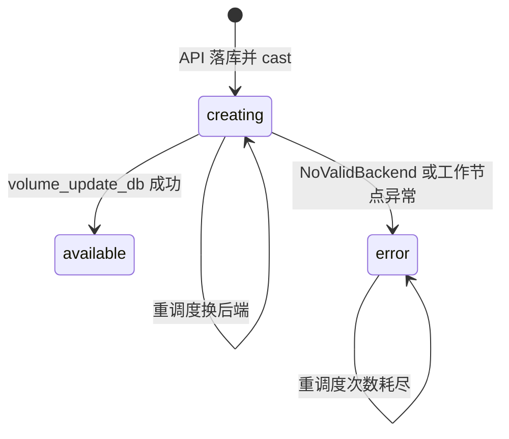

# WF-02 · 调度选后端与重调度

调度把 `request_spec` 转成唯一后端选择，并通过过滤 + 权重排序算出 `weighed_backends[0]`，再 RPC cast 给卷服务；失败时按 `filter_properties['retry']['num_attempts']` 与配置项 `scheduler_max_attempts` 决定是否换后端重试。它与卷生命周期通过 [`business/volume-lifecycle.md`](../business/volume-lifecycle.md) 的 `VolumeCastTask` 衔接，配额回滚分支与 [`business/quotas.md`](../business/quotas.md) 共享 `QUOTAS.rollback` 语义，后端状态字段归属见 [`business/domain-models/index.md`](../business/domain-models/index.md)。

## 1. 符号级端到端执行调用树

```text
Trigger: cinder/scheduler/rpcapi.py:94 SchedulerAPI.create_volume -> cctxt.cast(ctxt, 'create_volume', ...)
  └─ cinder/scheduler/manager.py:175 SchedulerManager.create_volume
       ├─ cinder/scheduler/manager.py:177 self._wait_for_scheduler()
       ├─ cinder/scheduler/manager.py:180 create_volume.get_flow(context, self.driver, request_spec, filter_properties, volume, snapshot_id, image_id)
       │    └─ cinder/scheduler/flows/create_volume.py:31 ExtractSchedulerSpecTask -> :75 ScheduleCreateVolumeTask
       │         ├─ cinder/scheduler/flows/create_volume.py:64 execute: request_spec 为 None 时 _populate_request_spec(volume, snapshot_id, image_id)
       │         └─ cinder/scheduler/flows/create_volume.py:119 execute: self.driver_api.schedule_create_volume(context, request_spec, filter_properties)
       └─ cinder/scheduler/filter_scheduler.py:89 FilterScheduler.schedule_create_volume
            ├─ cinder/scheduler/filter_scheduler.py:90 backend = self._schedule(context, request_spec, filter_properties)
            │    └─ cinder/scheduler/filter_scheduler.py:507 _schedule
            │         ├─ :508 weighed_backends = self._get_weighted_candidates(context, request_spec, filter_properties)
            │         │    └─ cinder/scheduler/filter_scheduler.py:236 _populate_retry: max_attempts==1 直接返回；否则 num_attempts += 1
            │         ├─ :513 if weighed_backends and group_backend -> 剔除 backend_id != group_backend 的候选
            │         └─ :525 self._choose_top_backend(weighed_backends, request_spec)
            │              └─ cinder/scheduler/filter_scheduler.py:545 backend_state.consume_from_volume(volume_properties)
            ├─ cinder/scheduler/filter_scheduler.py:92 if not backend -> raise NoValidBackend("No weighed backends available")
            ├─ cinder/scheduler/filter_scheduler.py:99 driver.volume_update_db(context, volume_id, backend.host, backend.cluster_name)
            ├─ cinder/scheduler/filter_scheduler.py:106 filter_properties.pop('context', None)  # context 不可序列化
            └─ cinder/scheduler/filter_scheduler.py:108 self.volume_rpcapi.create_volume(..., allow_reschedule=True)

失败回归路径:
  cinder/scheduler/flows/create_volume.py:123 except Exception as e -> :124 message_api.create(Action.SCHEDULE_ALLOCATE_VOLUME, resource_uuid=request_spec['volume_id'])
    ├─ :133 excutils.save_and_reraise_exception(reraise=not isinstance(e, exception.NoValidBackend))
    ├─ :136 self._handle_failure: rpc.get_notifier('scheduler').error(context, 'scheduler.create_volume', payload)
    └─ :138 common.error_out(volume, reason=e)   # 卷置 error
  工作节点侧重调度: cinder/volume/flows/manager/create_volume.py:57 OnFailureRescheduleTask
    ├─ :80 no_reschedule_types 命中 -> 不重调度，直接 error
    └─ :129 _reschedule -> retry_info['num_attempts'] 由 scheduler 端递增后重新 cast

其它调度入口:
  cinder/scheduler/manager.py:207 migrate_volume -> driver.backend_passes_filters(context, backend, request_spec, filter_properties)
  cinder/scheduler/manager.py:338 extend_volume -> filter_properties['new_size'] = new_size -> backend_state.consume_from_volume({'size': new_size - volume.size})
  cinder/scheduler/manager.py:244 retype -> 走类型变更后的后端筛选
  cinder/scheduler/manager.py:195 _do_cleanup: status == 'creating' 的卷在调度器死亡后置 'error'
```

## 2. 分阶段业务规则与精确判定表

| 阶段 | 负责函数（`路径:行号`） | 精确布尔条件 / 阈值常量 | 命中分支行为 | 状态或数据副作用 |
|---|---|---|---|---|
| 最大尝试次数校验 | `FilterScheduler._max_attempts` (`cinder/scheduler/filter_scheduler.py:210-216`) | `CONF.scheduler_max_attempts < 1` | 抛 `InvalidParameterValue("Invalid value for 'scheduler_max_attempts', must be >=1")` | 调度器初始化失败，配置项定义于 `cinder/scheduler/driver.py:35` |
| 重调度开关 | `FilterScheduler._populate_retry` (`cinder/scheduler/filter_scheduler.py:244-246`) | `max_attempts == 1` | 直接 `return`，不写 `filter_properties['retry']`，即禁用重调度 | retry 历史不落 filter_properties |
| 尝试计数 | `FilterScheduler._populate_retry` (`cinder/scheduler/filter_scheduler.py:248-257`) | `if retry: retry['num_attempts'] += 1` 否则初始化 `{'num_attempts': 1, 'backends': [], 'hosts': []}` | 写回 `filter_properties['retry']` | `backends`/`hosts` 记录已尝试后端（兼容旧字段名） |
| 超额拒绝 | `FilterScheduler._populate_retry` (`cinder/scheduler/filter_scheduler.py:262-267`) | `retry['num_attempts'] > max_attempts` | 抛 `NoValidBackend("Exceeded max scheduling attempts %(max_attempts)d for volume %(volume_id)s")` | 不再选后端，卷置 error |
| 无候选拒绝 | `FilterScheduler.schedule_create_volume` (`cinder/scheduler/filter_scheduler.py:92-94`) | `backend is None`（即 `_schedule` 返回 None，见 `:520-524`） | 抛 `NoValidBackend("No weighed backends available")` | 不调用 `volume_update_db` |
| 组后端一致性 | `FilterScheduler._schedule` (`cinder/scheduler/filter_scheduler.py:512-519`) | `weighed_backends and group_backend` 时逆序遍历，`utils.extract_host(backend.obj.backend_id) != group_backend` 即 `remove` | 仅保留与 group/CG 同后端的候选 | 影响最终 top backend |
| 顶层选择 | `FilterScheduler._choose_top_backend` (`cinder/scheduler/filter_scheduler.py:540-546`) | `top_backend = weighed_backends[0]`（权重最高） | `backend_state.consume_from_volume(volume_properties)` | 见下方容量规则 |
| 容量扣减 | `HostState.consume_from_volume` (`cinder/scheduler/host_manager.py:291-304`) | `free_capacity_gb == 'infinite'` 或 `'unknown'` 时不减；否则 `free_capacity_gb -= volume_gb` | 恒执行 `allocated_capacity_gb += volume_gb`、`provisioned_capacity_gb += volume_gb` | `updated = timeutils.utcnow()` |
| 池状态隔离 | `PoolState.__init__` (`cinder/scheduler/host_manager.py:316-323`) | `new_host = vol_utils.append_host(host, pool_name)`；`self.pools = None` | 池级状态不再嵌套子池 | 后端标识为 `host@backend#pool` |
| 迁移目标校验 | `SchedulerManager.migrate_volume` (`cinder/scheduler/manager.py:224-236`) | `driver.backend_passes_filters` 抛 `NoValidBackend` → `_migrate_volume_set_error`；其余异常先 `save_and_reraise_exception` 再置错 | 成功才 `volume_rpcapi.VolumeAPI().migrate_volume(context, volume, tgt_backend, force_copy)` | 错误时 `migration_status='error'`；`maintenance` 卷复位 `previous_status or 'maintenance'` |
| 扩容容量记账 | `SchedulerManager.extend_volume` (`cinder/scheduler/manager.py:349-362`) | `filter_properties['new_size'] = new_size`；`consume_from_volume({'size': new_size - volume.size})` | `NoValidBackend` 时 `QUOTAS.rollback(context, reservations, project_id=volume.project_id)` 并 `_extend_volume_set_error` | 失败卷状态置 `'available'` |
| 通知负载 | `SchedulerManager._set_volume_state_and_notify` (`cinder/scheduler/manager.py:377-392`) | `if volume_id: db.volume_update(context, volume_id, volume_state)`；`if volume_state.get('status') == 'error_managing': status = 'error'` | 发 `rpc.get_notifier('scheduler').error(context, 'scheduler.' + method, payload)` | payload 含 `request_spec`/`volume_properties`/`state`/`reason` |

## 3. 实体状态机与合法迁移约束



- **不可违反的不变量 1**：只有 `NoValidBackend` 会被 `cinder/scheduler/flows/create_volume.py:133-134` 判定为「无需重新抛出」；其余异常均 `reraise`，但无论哪类异常都会执行 `:138 common.error_out(volume, reason=e)`，因此 `creating` 卷必然收敛到 `available` 或 `error`，不会悬挂。
- **不可违反的不变量 2**：`retry['num_attempts'] > max_attempts` 是严格大于（`cinder/scheduler/filter_scheduler.py:262`），所以 `max_attempts=3` 时允许尝试序号 1、2、3，第 4 次才拒绝；`max_attempts=1` 在 `cinder/scheduler/filter_scheduler.py:244` 直接短路。
- **不可违反的不变量 3**：已尝试后端必须进入 `retry['backends']`，过滤器 `cinder/scheduler/filters/ignore_attempted_hosts_filter.py:34` 依赖 `filter_properties['retry']['num_attempts']` 结构剔除它们，禁止在重调度时清空该字典。
- **不可违反的不变量 4**：`filter_properties` 在 cast 前必须 `pop('context', None)`（`cinder/scheduler/filter_scheduler.py:106`），因为 `context` 不可 JSON 序列化；新增键必须是原始类型。

## 4. 幂等、并发互斥与异常补偿回滚表

| 边界 / 故障场景 | 源码检测条件（`路径:行号`） | 保护 / 回滚 / 降级动作 |
|---|---|---|
| 调度器在调度途中死亡 | `SchedulerManager._do_cleanup` (`cinder/scheduler/manager.py:195-202`)：`isinstance(vo_resource, objects.Volume) and vo_resource.status == 'creating'` | 复位为 `error` 并 `save()`，避免卷永久停在 `creating` |
| 调度器未就绪 | `SchedulerManager.create_volume` (`cinder/scheduler/manager.py:177`)、`migrate_volume` (`:210`) | `_wait_for_scheduler()` 阻塞等待，直到服务可用 |
| 目标后端不匹配 | `FilterScheduler.backend_passes_filters` (`cinder/scheduler/filter_scheduler.py:112-121`) | `_get_weighted_candidates` 过滤后比较 `backend_id`；无 pool 定义时 `ignore_pool = not bool(utils.extract_host(backend, 'pool'))` |
| 扩容调度失败 | `SchedulerManager.extend_volume` (`cinder/scheduler/manager.py:359-362`) | 回滚扩容预留的 `gigabytes` 配额，卷状态返回 `available` 并通知 |
| 迁移调度失败 | `SchedulerManager._migrate_volume_set_error` (`cinder/scheduler/manager.py:212-222`) | `maintenance` 卷同时复位 `status`，普通卷仅置 `migration_status='error'` |
| 后端能力未刷新 | `HostState.update_backend` (`cinder/scheduler/host_manager.py:284-289`) | `volume_backend_name`/`vendor_name`/`driver_version`/`storage_protocol` 取 `capability.get(key, None)`，`timestamp` 必填 |
| 工作节点建卷失败但源可恢复 | `OnFailureRescheduleTask.no_reschedule_types` (`cinder/volume/flows/manager/create_volume.py:80-98`) | `ImageCopyFailure` 等 9 类异常禁止换后端重试，防止本地残留卷被重复创建 |

## 5. 共变耦合与修改清单（Agent Co-Change Playbook）

- **修改本流程业务规则时必查联动点**：
  1. 调度 RPC 入向与版本协商：`cinder/scheduler/rpcapi.py:78-127`（`create_group` / `create_volume` / `migrate_volume` / `retype`），迁移在 `3.3` 与 `3.0` 间按 `self.client.can_send_version(version)` 切换参数名 `backend` / `host`。
  2. 工作节点失败重调度判别：`cinder/volume/flows/manager/create_volume.py:57-155`，契约见 [`business/volume-lifecycle.md`](../business/volume-lifecycle.md)。
  3. 配额回滚入口：`cinder/scheduler/manager.py:359-362` 与 `cinder/quota.py:1053-1071`，语义见 [`business/quotas.md`](../business/quotas.md)。
  4. 后端状态与池容量字段：`cinder/scheduler/host_manager.py:284-304`、`:316-323`，存储归属见 [`business/domain-models/index.md`](../business/domain-models/index.md)。
  5. 配置项 `scheduler_max_attempts` 定义与读取：`cinder/scheduler/driver.py:35`、`cinder/scheduler/filter_scheduler.py:210-216`；变更需同步 [`contracts/configuration.md`](../contracts/configuration.md)。
  6. 传输层 cast 语义与消息体：`cinder/scheduler/rpcapi.py:94-127`，下游契约见 [`integrations/downstream/rpc-messaging.md`](../integrations/downstream/rpc-messaging.md)。
- **隐式陷阱**：`_populate_retry` 在 `max_attempts == 1` 时完全不写 retry 字典（`cinder/scheduler/filter_scheduler.py:244-246`），此时 `ignore_attempted_hosts_filter.py` 读不到历史；若新增依赖 retry 历史的过滤器，必须同时处理该短路分支。
