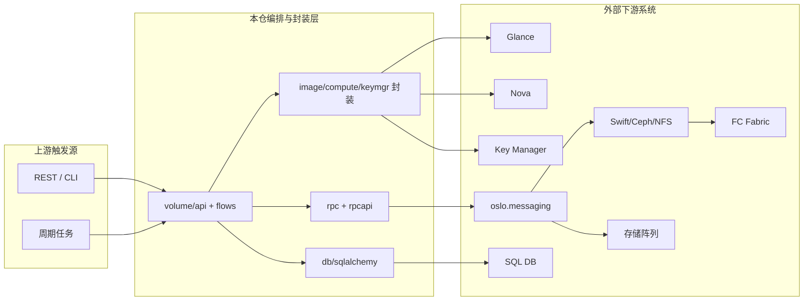

# 上下游集成与调用拓扑总览

Cinder 的上游是 REST 客户端与 cinder-manage，下游分两类：跨进程的 RPC 服务（scheduler/volume/backup）与进程外的外部系统（Glance、Nova、Swift、SQL 数据库、密钥管理、FC 交换机、存储阵列）。所有下游均在本仓有独立业务封装层，请求字典与返回解包字段在对应契约页逐 Key 展开，禁止只看传输基类。

## 1. 上下游调用拓扑图（Inbound ↔ Internal ↔ Outbound）

## 2. 仓内组件「上游有谁 ↔ 下游调谁」双向速查表

| 本仓组件 / 模块 | 源码路径 | 直接上游调用方（符号 + `路径:行号`） | 调用的仓内下游模块 | 调用的外部下游封装 | 组件架构页 |
|---|---|---|---|---|---|
| 卷 API 编排 | `cinder/volume/api.py` | `VolumeController.create` (`cinder/api/v3/volumes.py:197`) | `quota`、`volume/flows/api` | [Glance](downstream/glance.md)、[Key Manager](downstream/keymgr.md) | [api-service](../architecture/api-service.md) |
| 调度 RPC | `cinder/scheduler/rpcapi.py` | `VolumeCastTask._cast_create_volume` (`cinder/volume/flows/api/create_volume.py:730`) | `scheduler/manager.py` | [RPC 消息](downstream/rpc-messaging.md) | [core-engine](../architecture/core-engine.md) |
| 卷 RPC | `cinder/volume/rpcapi.py` | `cinder/volume/api.py` 各写操作 | `volume/manager.py` | [RPC 消息](downstream/rpc-messaging.md) | [async-job-worker](../architecture/async-job-worker.md) |
| 备份 RPC | `cinder/backup/rpcapi.py` | `cinder/backup/api.py:68` | `backup/manager.py` | [Swift 备份](downstream/swift-backup.md) | [async-job-worker](../architecture/async-job-worker.md) |
| 卷管理器 | `cinder/volume/manager.py` | `VolumeAPI.create_volume` | `volume/driver.py`、`db/api.py` | [存储驱动](downstream/storage-drivers.md)、[SQLAlchemy](downstream/sqlalchemy-db.md) | [core-engine](../architecture/core-engine.md) |
| 计算通知 | `cinder/compute/nova.py` | `cinder/volume/api.py` 扩容/迁移后 | — | [Nova](downstream/nova.md) | [data-and-adapter](../architecture/data-and-adapter.md) |
| FC Zone | `cinder/zonemanager/utils.py` | 驱动 `initialize_connection` 装饰器 (`:76-121`) | — | [FC Zone Manager](downstream/zonemanager.md) | [data-and-adapter](../architecture/data-and-adapter.md) |

## 3. 外部下游依赖系统全量清单（Downstream Registry）

> **强制区分传输底座与业务封装层**：`cinder/rpc.py` 与 `cinder/db/sqlalchemy/api.py` 只是传输/持久化底座；真正组装业务字典的是下表「业务封装文件」列，各页已逐 Key 展开。

| 下游系统名 | 承担业务职责 | 协议与成功码判定 | 底层传输基类（`路径:行号`） | 本仓业务封装文件（组装参数层） | 封装方法数 | 超时 / 重试配置 | 出向字典契约专页 |
|---|---|---|---|---|---|---|---|
| `oslo.messaging RPC` | 跨进程编排 scheduler/volume/backup | `cast` 无回执；`call` 同步返回 | `rpc.get_client/get_server` (`cinder/rpc.py:141,150`) | `cinder/{volume,scheduler,backup}/rpcapi.py` | 40+ | `rpc_response_timeout` | [RPC 消息](downstream/rpc-messaging.md) |
| `Glance` | 镜像元信息查询、从镜像创建卷 | glanceclient `images.get/list` 成功 | `GlanceClientWrapper.call` (`cinder/image/glance.py:179`) | `cinder/image/glance.py` (`GlanceImageService`) | 12+ | `glance_num_retries` (`glance.py:190`) | [Glance](downstream/glance.md) |
| `Nova` | 挂载事件通知、扩容事件、快照协助 | `nova.server_external_events.create` 返回 `code==200` | `novaclient` (`cinder/compute/nova.py:107`) | `cinder/compute/nova.py` (`API`) | 7 | `timeout` 参数 (`nova.py:107`) | [Nova](downstream/nova.md) |
| `SQL 数据库` | 卷/快照/备份/配额持久化 | SQLAlchemy `model_query` 返回行 | `oslo_db` session (`cinder/db/sqlalchemy/api.py:99-115`) | `cinder/db/sqlalchemy/api.py` + `cinder/objects/*` | 100+ | `connection` / `max_pool_size` | [SQLAlchemy](downstream/sqlalchemy-db.md) |
| `Swift` | 卷备份对象存储 | `put_object` 返回 etag 等于本地 MD5 | `swift.Connection` (`cinder/backup/drivers/swift.py:209,251`) | `cinder/backup/drivers/swift.py` (`SwiftBackupDriver`) | 7 | `backup_swift_retry_attempts` | [Swift 备份](downstream/swift-backup.md) |
| `Ceph / NFS / POSIX / GlusterFS / TSM / Google` | 其他备份后端 | 驱动各自 `backup()` 返回 model_update | `BackupDriver` (`cinder/backup/driver.py:348`) | `cinder/backup/drivers/*.py` | 6 套 | 各驱动配置组 | [存储驱动](downstream/storage-drivers.md) |
| `Key Manager` | 卷加密密钥存取 | `create_key` 返回 UUID；`get` 返回 SymmetricKey | `castellan.key_manager` (`cinder/keymgr/conf_key_mgr.py:57`) | `cinder/keymgr/conf_key_mgr.py` | 5 | 无网络调用（配置型） | [密钥管理](downstream/keymgr.md) |
| `FC Fabric 交换机` |  zone 添加/删除 | `ZoneManager.add_connection/delete_connection` 无异常 | `FCSanLookupService` (`cinder/zonemanager/utils.py:54`) | `cinder/zonemanager/utils.py` 装饰器 | 2 | 驱动配置 | [FC Zone](downstream/zonemanager.md) |
| `存储阵列 / LVM` | 卷创建、删除、快照、连接导出 | 驱动方法返回 model_update / connection_info | `VolumeDriver` (`cinder/volume/driver.py:2114`) | `cinder/volume/drivers/*`、`cinder/interface/util.py` | 30+ 驱动 | 各后端配置组 | [存储驱动](downstream/storage-drivers.md) |

## 4. 共变耦合与修改清单（Co-Change Playbook）

1. 给下游方法新增入参键：改对应 `downstream/<target>.md` 记录的封装文件字典拼装 → 核对 [字段映射矩阵](topology-and-mapping.md) 的上游来源 → 更新 `cinder/tests/unit/` 中对应下游 Mock 断言。
2. 新增外部系统：在 `cinder/interface/` 定义接口、在 `setup.cfg` 注册入口点、在本页第 3 节登记并新建 `integrations/downstream/<target>.md`（必须含完整请求字典 Key 表与返回解包表）。
3. 改 RPC 载荷：同步 [RPC 契约](downstream/rpc-messaging.md) 的 `msg_args` 表、进程版本常量与 [主干调用链](../overview/callchain-panorama.md) 的桥接表。
