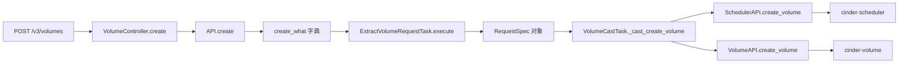

# 入向 DTO → 编排转换 → 下游请求字典的字段级映射矩阵

以「创建卷」为唯一贯穿场景，精确追踪 REST 请求体 `body['volume']` 经 API 层改名、编排层 `create_what` 汇聚、Taskflow 任务解包成 `RequestSpec`，最终落入 scheduler 与 volume 两侧 RPC `msg_args` 字典的全过程。

## 1. 入向入口 → 下游扇出编排顺序表

| 入向入口 | 主编排函数（路径:行号） | 按序调用的下游封装方法链（含条件分支） | 短路 / 聚合规则 |
|---|---|---|---|
| `POST /v3/volumes` | `VolumeController.create` (`cinder/api/v3/volumes.py:197-327`) | 1. `validate_name_and_description` (`:229`) → 2. `objects.VolumeType.get_by_name_or_id` (`:254-255`) → 3. `_image_uuid_from_ref` (`:311`，仅 `os-image-create` 扩展已加载) → 4. `volume_api.create` (`:319-323`) | `source_replica` 存在即抛 `InvalidInput` (`:232-237`)；快照/源卷/组 ID 非 UUID 即 `HTTPBadRequest` (`:261-263`、`:272-275`、`:287-290`) |
| 编排入口 | `API.create` (`cinder/volume/api.py:218-366`) | 1. `check_policy` (`:226`) → 2. `list_availability_zones` (`:299`) → 3. `utils.check_metadata_properties` (`:304`) → 4. 组装 `create_what` (`:306-326`) → 5. `create_volume.get_flow` (`:336-341`) → 6. `flow_engine.run` (`:352`) | 组/一致性组场景把 `sched_rpcapi`、`volume_rpcapi` 置 `None` (`:328-335`)，直接绕过 RPC 扇出 |
| 任务流中转 | `VolumeCastTask.execute` (`cinder/volume/flows/api/create_volume.py:790-802`) | 1. `objects.RequestSpec(**kwargs)` (`:798`) → 2. `_cast_create_volume` (`:802`) | `scheduler_hints` 从 kwargs 弹出并并入 `filter_properties` (`:791`、`:800-801`) |
| 下游扇出 | `VolumeCastTask._cast_create_volume` (`cinder/volume/flows/api/create_volume.py:730-788`) | 分支一 `scheduler_rpcapi.create_volume` (`:768-774`)；分支二 `volume_rpcapi.create_volume` (`:783-788`) | `source_volume_ref` 非空（来自快照同主机或克隆源）时走分支二并 `allow_reschedule=False`；`cgsnapshot_id` 存在时连分支二也跳过 |



## 2. 核心场景字段级映射矩阵

### 2.1 入参字段 → `create_what` 字典键

| 入向字段路径（类型） | 转换 / 校验 / 默认值逻辑 | 目标下游封装方法 | `create_what` 精确键路径（类型） | 组装源码锚点 |
|---|---|---|---|---|
| `body['volume']['name']` (`str`) | `volume.pop('name')` 改写为 `display_name` (`cinder/api/v3/volumes.py:240-241`) | `API.create(name=...)` | `name` (`str`) | `cinder/volume/api.py:309` |
| `body['volume']['description']` (`str`) | 改写为 `display_description` (`cinder/api/v3/volumes.py:245-246`) | `API.create(description=...)` | `description` (`str`) | `cinder/volume/api.py:310` |
| `body['volume']['image_id']` (`str`) | 改写为 `imageRef` (`:248-249`)，再经 `_image_uuid_from_ref` 转 UUID (`:311-312`) | `API.create(image_id=...)` | `image_id` (`str`) | `cinder/volume/api.py:312` |
| `body['volume']['volume_type']` (`str`) | `objects.VolumeType.get_by_name_or_id` 解析成对象 (`cinder/api/v3/volumes.py:251-255`) | `API.create(volume_type=...)` | `raw_volume_type` (`VolumeType`) | `cinder/volume/api.py:313` |
| `body['volume']['metadata']` (`dict`) | 缺省 `None` 直接透传 (`:257`) | `API.create(metadata=...)` | `metadata` (`dict`，`metadata or {}`) | `cinder/volume/api.py:314` |
| `body['volume']['snapshot_id']` (`str`) | UUID 校验 + `volume_api.get_snapshot` (`:259-268`) | `API.create(snapshot=...)` | `snapshot` (`Snapshot`) | `cinder/volume/api.py:311` |
| `body['volume']['source_volid']` (`str`) | UUID 校验 + `volume_api.get_volume` (`:270-281`) | `API.create(source_volume=...)` | `source_volume` (`Volume`) | `cinder/volume/api.py:316` |
| `body['volume']['consistencygroup_id']` / `['group_id']` (`str`) | `group_api.get` (`:285-298`) | `API.create(group=...)` | `consistencygroup` / `group` (`Group`) | `cinder/volume/api.py:320`、`:323` |
| `body['volume']['size']` (`int`) | 空值回退到快照 `volume_size` 或源卷 `size` (`cinder/api/v3/volumes.py:300-304`) | `API.create(size=...)` | `raw_size` (`int`) | `cinder/volume/api.py:308` |
| `body['volume']['availability_zone']` (`str`) | 无转换透传 (`cinder/api/v3/volumes.py:314`) | `API.create(availability_zone=...)` | `raw_availability_zone` (`str`) | `cinder/volume/api.py:315` |
| `body['volume']['scheduler_hints']` (`dict`) | 无转换透传 (`:315`) | `API.create(scheduler_hints=...)` | `scheduler_hints` (`dict`) | `cinder/volume/api.py:317` |
| `body['volume']['multiattach']` (`bool`) | 缺省 `False` (`:316-317`) | `API.create(multiattach=...)` | `multiattach` (`bool`) | `cinder/volume/api.py:322` |
| *(上下文隐式注入)* | `req.environ['cinder.context']` (`cinder/api/v3/volumes.py:208`) | 全部下游公共字段 | `context` (`RequestContext`) | `cinder/volume/api.py:307` |
| *(编排层隐式注入)* | `self.key_manager` | 加密卷密钥查找 | `key_manager` (`KeyManager`) | `cinder/volume/api.py:318` |
| *(编排层固定值)* | 固定字典 | 配额提交标记 | `optional_args` = `{'is_quota_committed': False}` | `cinder/volume/api.py:319` |

### 2.2 `create_what` → 任务产出字典 → RPC 字典键

| 中间键（来源） | 转换函数（路径:行号） | 任务产出键 | 最终下游字典键路径 | 组装源码锚点 |
|---|---|---|---|---|
| `raw_size` | `_extract_size` (`cinder/volume/flows/api/create_volume.py:429`) | `size` (`:483`) | `request_spec['size']` | `cinder/volume/flows/api/create_volume.py:798` |
| `snapshot` | `_extract_snapshot` (`:427`) | `snapshot_id` (`:484`) | `msg_args['snapshot_id']` | `cinder/scheduler/rpcapi.py:98` |
| `image_id` | `_get_image_metadata` (`:195`、`:434-436`) | 不落入产出字典，作为独立参数 | `msg_args['image_id']` | `cinder/scheduler/rpcapi.py:99` |
| `source_volume` | `_extract_source_volume` (`:428`) | `source_volid` (`:485`) | `request_spec['source_volid']` | `cinder/volume/flows/api/create_volume.py:798` |
| `raw_availability_zone` | `_extract_availability_zone` (`:438-439`) | `availability_zone`、`refresh_az` (`:486`、`:495`) | `request_spec['availability_zone']` | `cinder/volume/flows/api/create_volume.py:798` |
| `raw_volume_type` | `_get_volume_type_id` (`:452-453`) | `volume_type`、`volume_type_id` (`:487-488`) | `request_spec['volume_type_id']` | `cinder/volume/flows/api/create_volume.py:798` |
| `key_manager` | `_get_encryption_key_id` (`:357`、`:455-461`) | `encryption_key_id` (`:489`) | `request_spec['encryption_key_id']` | `cinder/volume/flows/api/create_volume.py:798` |
| `metadata` | `utils.check_metadata_properties` (`cinder/volume/api.py:304`) | 不改写 | `request_spec['metadata']` | `cinder/volume/flows/api/create_volume.py:798` |
| `scheduler_hints` | 从 kwargs 弹出 (`:791`) | 不落入 RequestSpec | `filter_properties['scheduler_hints']` | `cinder/volume/flows/api/create_volume.py:800-801` |
| `consistencygroup` | `_extract_consistencygroup` (`:430`) | `consistencygroup_id` (`:491`) | `request_spec['CG_backend']`（仅一致性组非空） | `cinder/volume/flows/api/create_volume.py:742-743` |
| `group` | `_extract_group` (`:432`) | `group_id` (`:493`) | `request_spec['group_backend']`（仅组非空） | `cinder/volume/flows/api/create_volume.py:747-752` |

### 2.3 下游返回 → 上游回填

| 下游返回键路径 | 判空 / 转换规则 | 回填目标 | 解包源码锚点 |
|---|---|---|---|
| `flow_engine.storage.fetch('volume')` (`Volume`) | 无判空，直接作为创建结果 | `API.create` 返回值 → `_view_builder.detail` | `cinder/volume/api.py:353`、`:361`；`cinder/api/v3/volumes.py:325` |
| `flow_engine.storage.fetch('refresh_az')` (`bool`) | 为真时刷新可用区缓存 | `list_availability_zones(refresh_cache=True)` | `cinder/volume/api.py:356-358` |

## 3. 通用字典拼装模式

- **公共信封构造器**：`create_what` (`cinder/volume/api.py:306-326`) 固定 18 个键；`RequestSpec(**kwargs)` (`cinder/volume/flows/api/create_volume.py:798`) 把任务产出整体转成版本化对象；`msg_args` 字典由三个 `rpcapi.py` 各自组装。
- **扇出分流器**：`_cast_create_volume` (`cinder/volume/flows/api/create_volume.py:730-788`)，两条分支互斥，分别调用 `cinder/scheduler/rpcapi.py:94-101` 与 `cinder/volume/rpcapi.py:160-167`。
- **条件键剔除**：`VolumeAPI.attach_volume` 在版本低于 3.3 时 `msg_args.pop('volume')` (`cinder/volume/rpcapi.py:204-207`)；`detach_volume` 在低于 3.4 时同样剔除 (`:213-216`)。

## 4. 符号级条件调用树

```text
POST /v3/volumes -> cinder/api/v3/volumes.py:197 VolumeController.create(req, body)
  ├─ [改名] cinder/api/v3/volumes.py:240-249 name->display_name, description->display_description, image_id->imageRef
  ├─ [guard] cinder/api/v3/volumes.py:232-237 source_replica -> InvalidInput
  └─ [编排] cinder/volume/api.py:218 API.create(context, size, name, description, **kwargs)
       ├─ [组装] cinder/volume/api.py:306-326 create_what（18 键）
       ├─ [guard] cinder/volume/api.py:244-249 size 非正整数 -> InvalidInput
       ├─ [任务] cinder/volume/flows/api/create_volume.py:416 ExtractVolumeRequestTask.execute -> 产出 13 键
       └─ [扇出] cinder/volume/flows/api/create_volume.py:790 VolumeCastTask.execute
            ├─ [if source_volume_ref] cinder/volume/rpcapi.py:160 VolumeAPI.create_volume -> cast(volume)
            └─ [else] cinder/scheduler/rpcapi.py:94 SchedulerAPI.create_volume -> cast(msg_args)
```

## 5. 共变耦合与修改清单

- **新增透传字段标准改动链**：
  1. REST 入向字段与校验：`cinder/api/v3/volumes.py:227-317`。
  2. 编排签名与 `create_what` 注入：`cinder/volume/api.py:218-224`、`:306-326`。
  3. Taskflow `requires` 与 `execute` 产出：`cinder/volume/flows/api/create_volume.py:416-496`、`:719-725`。
  4. 下游 `msg_args` 写入：参见 [RPC 扇出契约](downstream/rpc-messaging.md) 与 [数据库 DAO 契约](downstream/sqlalchemy-db.md)。
  5. 镜像来源字段同步：参见 [Glance 镜像服务契约](downstream/glance.md)；加密键同步：参见 [密钥管理契约](downstream/keymgr.md)。
- **隐式陷阱**：`name`/`description`/`image_id` 在 API 层已被改名，编排层使用的是 `display_name`/`display_description`/`imageRef` 语义，新增字段时不可重复改名；`optional_args` 与 `key_manager` 无 REST 入参来源，只在编排层注入。
