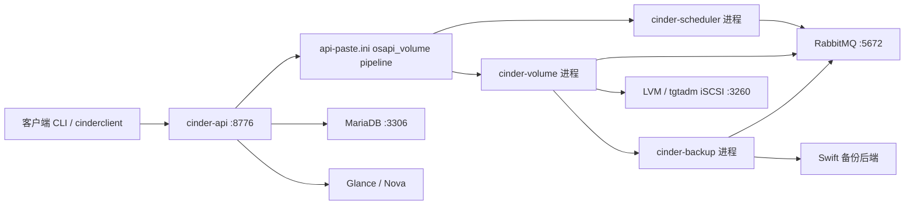

# 部署产物、进程拓扑与持久化目录契约

本页记录 Cinder 的打包发布产物、运行期进程与容器拓扑、宿主机持久化卷目录及 IPC/网络边界。仓库本体不产出 Docker 镜像，容器化部署资产位于 `contrib/block-box/`，以 noauth + Docker Compose 演示。配置项默认值与覆盖链见 [配置项全集](../contracts/configuration.md)，启动命令见 [构建与测试手册](dev-and-test.md)，故障定位见 [可观测性信号与故障定位决策树](runbook-and-observability.md)。

## 1. 构建资产清单

| 构建文件（`路径`） | 构建产物 | 注入的关键目录与运行用户约束 | 源码锚点 |
|---|---|---|---|
| `setup.cfg:23-25` | Python 发行包（`packages = cinder`） | pbr 构建钩子 `pbr.hooks.setup_hook` (`setup.cfg:20-21`) | `setup.cfg:20-25` |
| `setup.cfg:48-58` | 8 个 console_scripts + 1 个 wsgi_script | `cinder-wsgi = cinder.wsgi.wsgi:initialize_application` | `setup.cfg:48-58` |
| `contrib/block-box/Makefile:1-19` | `cinder`、`cinder-lvm`、`cinder-devenv` 三类镜像 | `base` 由 loci-cinder 远程构建，`lvm`/`devbox` 用本地 Dockerfile；变量 `CINDER_BRANCH`/`PLATFORM`/`TAG` | `contrib/block-box/Makefile:1-19` |
| `contrib/block-box/README.md:1-40` | 容器化 Cinder 说明 | 说明 noauth 模式、loci 构建与镜像用途 | `contrib/block-box/README.md:1-40` |
| `contrib/block-box/docker-compose.yml:1-80` | 多容器编排 | rabbitmq、mariadb、cinder-api、cinder-scheduler、cinder-volume 五个服务 | `contrib/block-box/docker-compose.yml:1-80` |
| `contrib/block-box/etc-cinder/cinder.conf:1-23` | 运行配置挂载 | noauth、`state_path=/var/lib/cinder`、`enabled_backends=lvm`、MySQL 连接串 | `contrib/block-box/etc-cinder/cinder.conf:1-23` |

## 2. 运行期进程拓扑

API 进程有两条启动路径：`cinder-api` 直接 `eventlet.monkey_patch()` 后经 `service.process_launcher()` 启 `WSGIService('osapi_volume')`（`cinder/cmd/api.py:20-21`、`47-63`）；`cinder-wsgi` 通过 `initialize_application()` 交给 `oslo_service.wsgi.Loader.load_app('osapi_volume')` 供 Apache mod_wsgi 加载（`cinder/wsgi/wsgi.py:38-46`，`etc/cinder/api-httpd.conf:1-14` 以 `WSGIDaemonProcess osapi_volume processes=2 threads=1 user=cinder` 运行）。

`service.wait()` 在退出前遍历全部 `CONF` 并记录，含 `_password`/`_key` 或 URI 型 `sql_connection` 的项被替换为 `FLAG SET`，防止口令入日志（`cinder/service.py:647-664`）。

## 3. 运行期持久化目录与卷契约

| 目录 / 文件（`路径`） | 作用 | 契约与约束 | 源码锚点 |
|---|---|---|---|
| `/var/lib/cinder` | `state_path` 顶层状态目录 | 默认 `/var/lib/cinder`，旧名 `pybasedir` | `cinder/common/config.py:40-43`
| `/var/lib/cinder/volumes` | `volumes_dir` 卷文件目录 | block-box 示例显式设定 | `contrib/block-box/etc-cinder/cinder.conf:10`
| `/var/lock/cinder` | `lock_path` 锁目录 | 多进程协调写锁 | `contrib/block-box/etc-cinder/cinder.conf:9`
| `/etc/cinder/api-paste.ini` | WSGI pipeline 定义 | 挂载 `/`、`/v1`、`/v2`、`/v3` 三套 API | `etc/cinder/api-paste.ini:5-10` |
| `/etc/cinder/rootwrap.conf` | rootwrap 过滤器根配置 | `filters_path=/etc/cinder/rootwrap.d,/usr/share/cinder`；`exec_dirs` 仅含受信任目录；`use_syslog=False`、`syslog_log_level=ERROR` | `etc/cinder/rootwrap.conf:1-27` |
| `/etc/cinder/rootwrap.d` | 特权命令过滤器 | 必须仅 root 可写 | `etc/cinder/rootwrap.conf:8-12` |
| `/etc/cinder/resource_filters.json` | 通用过滤白名单 | 定义 volume/backup/snapshot/group/attachment/message/pool 各自允许的过滤键 | `etc/cinder/resource_filters.json:1-12` |
| `/etc/cinder/policy.json` | API 策略规则 | `default=rule:admin_or_owner`；admin action 为 `rule:admin_api` | `etc/cinder/policy.json:1-10` |
| `./db-data`（容器相对） | mariadb 数据卷 | 挂载至 `/var/lib/mysql` | `contrib/block-box/docker-compose.yml:21-23` |
| `/dev/`、`/run/`、`/lib/modules` | cinder-volume 容器特权挂载 | `privileged: true`，`/run/` 以 `:shared` 共享，`/etc/localtime` 只读 | `contrib/block-box/docker-compose.yml:61-66` |
| `/var/log/apache2/cinder*.log` | Apache mod_wsgi 部署日志 | `ErrorLog`/`CustomLog` 分别记录错误与访问 | `etc/cinder/api-httpd.conf:11-12` |

## 4. IPC 与网络边界

| 边界类型 | 方向与端口/协议 | 调用模块（`路径:行号`） | 安全与超时约束 |
|---|---|---|---|
| 入向监听（原生） | `HTTP 8776` | `cinder/cmd/api.py:59-63` (`WSGIService`) | pipeline 含 `authtoken`/`keystonecontext` 或 `noauth` (`etc/cinder/api-paste.ini:24-28`) |
| 入向监听（Apache） | `HTTP 8776`，`WSGIDaemonProcess processes=2 threads=1` | `etc/cinder/api-httpd.conf:1-14`、`cinder/wsgi/wsgi.py:38-46` | `WSGIPassAuthorization On` 传递鉴权头；运行用户 `cinder` |
| 内部 RPC | RabbitMQ `5672` | `cinder/cmd/api.py:59` (`rpc.init`)、`cinder/service.py:664` (`rpc.cleanup`) | 容器经 `extra_hosts` 静态解析 `rabbitmq:172.49.49.5` (`contrib/block-box/docker-compose.yml:35-37`) |
| 数据库 | MySQL/MariaDB `3306` | `contrib/block-box/etc-cinder/cinder.conf:13-14` | 连接串含口令仅存在于受控配置挂载，不入库不回显 |
| 块设备 / iSCSI | `tgtadm` + `3260` | `contrib/block-box/docker-compose.yml:70-77` | `cinder-volume` 特权容器启动 `tgtd` 后以 `-d` 后台运行 |
| 出向 HTTPS | Glance / Nova / Swift 客户端 | `cinder/image/glance.py:220-224`、`cinder/compute/nova.py:235-243` | 失败翻译见 [错误码字典](../contracts/error-codes.md) |
| 特权命令 | `cinder-rootwrap` → `sudo`/过滤器 | `cinder/common/config.py:145-148`、`etc/cinder/rootwrap.conf:1-27` | 固定 `argv` 由过滤器约束，`exec_dirs` 白名单，禁止任意 shell |

容器网络细节：`cinder-api`、`cinder-scheduler`、`cinder-volume` 均使用 `network_mode: "host"`（`contrib/block-box/docker-compose.yml:30`、`53`、`75`），仅 RabbitMQ/MariaDB 在自定义 `cindernet` 网段（`:9-23`）；`cinder.rc` 将 `CINDER_ENDPOINT` 指向 `http://127.0.0.1:8776/v3`、`CINDER_ENDPOINT` 协议版本 `3.27`，并以 `OS_AUTH_SYSTEM=noauth` 连接（`contrib/block-box/cinder.rc:1-5`）。

## 5. 共变耦合与修改清单

| 变更点 | 联动文件 | 隐式陷阱与标准动作 |
|---|---|---|
| 改监听端口 | `etc/cinder/api-httpd.conf:1-14`、`contrib/block-box/docker-compose.yml:30-32`、`contrib/block-box/cinder.rc:2` | 三处端口必须一致；`network_mode: host` 下端口冲突会直接导致容器起不来 |
| 改 rootwrap 过滤器 | `etc/cinder/rootwrap.conf:1-27`、`etc/cinder/rootwrap.d/`、`cinder/common/config.py:145-148` | 过滤器目录必须仅 root 可写；新增特权命令需同步过滤器定义与 `exec_dirs` |
| 改挂载卷 | `contrib/block-box/docker-compose.yml:21-23`、`61-66`、`contrib/block-box/etc-cinder/cinder.conf:5-9` | `state_path`/`volumes_dir`/`lock_path` 与容器卷目标路径需对应，否则数据落在容器可写层并随重建丢失 |
| 改 API pipeline | `etc/cinder/api-paste.ini:5-75`、`cinder/cmd/api.py:47-63`、`cinder/wsgi/wsgi.py:38-46` | 两种启动方式共用同一 ini，改中间件顺序会同时影响原生与 Apache 部署 |
| 改资源过滤白名单 | `etc/cinder/resource_filters.json:1-12`、`cinder/api/v3/attachments.py:38-69` | `resource_filters` 接口对外暴露该文件内容，改后同步 [接口参数字典](../contracts/api/v3-volumes.md) |

启动命令与测试入口见 [构建、启动与单测验证手册](dev-and-test.md)；配置默认值见 [配置项、环境变量与动态开关全集](../contracts/configuration.md)。
