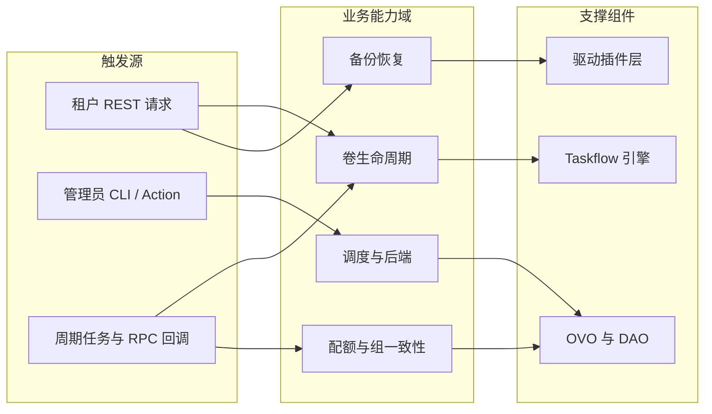

# 业务架构全景

Cinder 面向三类触发角色：租户通过 REST API 申请云硬盘与快照，管理员通过 cinder-manage / 扩展 Action 运维后端，cinder-scheduler 与 cinder-volume 的周期任务驱动状态收敛。业务闭环围绕卷生命周期展开：配额准入 → Taskflow 编排 → 调度选后端 → 驱动落盘 → 状态回写；备份、组一致性、消息审计是挂在同一状态机上的旁支能力。

## 1. 角色触发源与业务域拓扑

## 2. 业务域边界与能力矩阵

| 业务域标识 | 业务域名称 | 核心业务职责 | 核心状态实体 | 归属代码模块 | 核心准入/配额约束 | 关联业务清单 |
|---|---|---|---|---|---|---|
| `DOM-01` | 卷生命周期 | 创建、删除、挂载、扩容、迁移、retype、回滚快照 | `Volume`、`VolumeAttachment` | `cinder/volume/api.py:122`、`cinder/volume/manager.py:184` | `size > 0` (`cinder/volume/api.py:244-249`)、`source_replica` 已废弃 (`:229-233`) | [业务总表](../business/index.md) |
| `DOM-02` | 调度与后端 | 按 extra_specs / capacity / affinity 选后端，重调度 | `RequestSpec`、`BackendState` | `cinder/scheduler/filter_scheduler.py:37`、`cinder/scheduler/host_manager.py:92` | `scheduler_max_attempts` 上限 (`cinder/scheduler/filter_scheduler.py:210`) | [调度流程](../business/scheduling.md) |
| `DOM-03` | 备份恢复 | 导出卷到 Swift/Ceph/NFS，跨后端恢复、导入导出 | `Backup` | `cinder/backup/api.py:68`、`cinder/backup/manager.py:84` | 源必须处于 `backing-up` (`cinder/backup/manager.py:308-340`) | [备份流程](../business/backup-restore.md) |
| `DOM-04` | 配额与组一致性 | 项目级资源上限、卷类型配额、Group 与组快照一致性 | `Quota`、`Group`、`GroupSnapshot` | `cinder/quota.py:822`、`cinder/group/api.py:91` | `reservations + in_use + delta <= limit` (`cinder/db/sqlalchemy/api.py:1146-1310`) | [配额流程](../business/quotas.md) |
| `DOM-05` | 审计与消息 | 异步操作失败时写入 `messages` 表供用户查询 | `Message` | `cinder/message/api.py:40`、`cinder/objects/fields.py:25` | 消息过期由调度器清理 (`cinder/scheduler/manager.py:100-105`) | [业务总表](../business/index.md) |

## 3. 全量业务流程主索引（`WF-*`）

| 流程 ID | 流程名称 | 触发入口（路由 / 定时器 / 命令） | 串联组件与下游（按执行序） | 关键状态迁移 | 流程专页 |
|---|---|---|---|---|---|
| `WF-01` | 卷创建与删除闭环 | `POST /v3/{project_id}/volumes` (`cinder/api/v3/volumes.py:197`) | API → Taskflow → Scheduler RPC → Volume RPC → Driver → DB | `creating → available / error` | [卷生命周期](../business/volume-lifecycle.md) |
| `WF-02` | 后端筛选与重调度 | `SchedulerAPI.create_volume` (`cinder/scheduler/rpcapi.py:94`) | SchedulerManager → FilterScheduler → HostManager → Volume RPC | `creating → migrating / error` | [调度流程](../business/scheduling.md) |
| `WF-03` | 备份创建与恢复 | `POST /v3/{project_id}/backups` (`cinder/api/contrib/backups.py:36`) | Backup API → Backup RPC → BackupManager → brick → Swift/Ceph | `creating → available → restoring` | [备份恢复](../business/backup-restore.md) |
| `WF-04` | 配额预留与提交 | `QUOTAS.reserve` (`cinder/volume/api.py:327` 之前由 Taskflow 调用) | QuotaEngine → DbQuotaDriver → `quotas/quota_usages/reservations` | `reserved → committed / rolled back` | [配额流程](../business/quotas.md) |
| `WF-05` | 组与一致性快照 | `POST /v3/{project_id}/groups` (`cinder/api/v3/groups.py`) | Group API → VolumeManager.create_group → 驱动 group 接口 | `creating → available / updating / deleting` | [组与快照](../business/groups-and-snapshots.md) |

## 4. 全局业务不变量（不可破坏的业务红线）

1. **权限与资源归属不变量**：跨项目访问必须被 `check_policy` 拦截 —— 校验锚点 `cinder/volume/api.py:105-119`、`cinder/policy.py:37-73`。
2. **配额先于落盘不变量**：`QuotaReserveTask.execute` 必须在 `EntryCreateTask` 之后、驱动调用之前完成，失败即中止任务图 —— 校验锚点 `cinder/volume/flows/api/create_volume.py:600-687`。
3. **幂等与防重入不变量**：同一资源的并发删除由 `COORDINATOR.get_lock`（锁名为资源标识加 `-delete_` 后缀）串行化 —— 校验锚点 `cinder/volume/manager.py:624-650`。
4. **状态与迁移态正交不变量**：`migration_status='target:...'` 只标识迁移目标卷，不替代 `status` —— 校验锚点 `cinder/volume/manager.py:2027`。
5. **敏感凭据安全不变量**：RPC 日志按 `_password` / `_key` / `sql_connection` 关键字脱敏 —— 校验锚点 `cinder/service.py:647-659`。

## 5. 共变耦合与修改清单（Co-Change Playbook）

- 改任一业务域的准入条件：先改对应 `business/<workflow>.md` 的规则表 → 同步 `contracts/api-reference.md` 的入参字典 → 更新 `cinder/tests/unit/api/` 与 `cinder/tests/unit/volume/` 的边界用例。
- 新增业务域：在 `cinder/objects/fields.py` 定义状态枚举 → 在 `cinder/db/sqlalchemy/models.py` 落表 → 在 [领域模型总览](../business/domain-models/index.md) 登记 Writer/Reader → 回到本页第 2 节补一行能力矩阵。
