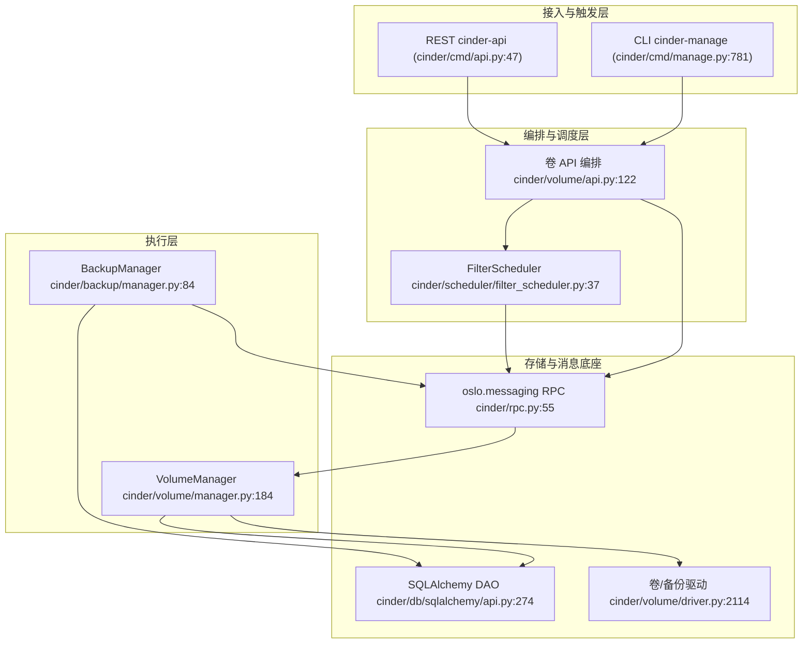

# 系统技术架构

Cinder 由四类独立进程组成：`cinder-api` 提供 WSGI REST 入口，`cinder-scheduler` 做后端筛选，`cinder-volume` 承载驱动与卷状态机，`cinder-backup` 负责备份导出；四类进程共享 SQLAlchemy 持久层，并通过 oslo.messaging RPC 协调，启动装配统一走 `Service.create`。核心隔离红线是 API 只做参数校验与编排，不直接访问存储驱动；调度只做选择，不执行卷落盘。

## 1. 运行时分层与依赖拓扑



| 架构层 | 包含目录 / 文件 | 核心职责 | 越界禁令（Agent 修改红线） |
|---|---|---|---|
| 接入与触发层 | `cinder/api/`、`cinder/wsgi/`、`cinder/cmd/` | Paste 管线组装、鉴权、versioned method 分发、CLI 子命令 | 禁止在 Controller 内直接拼 SQL 或调驱动私有方法 |
| 业务编排层 | `cinder/volume/api.py`、`cinder/backup/api.py`、`cinder/quota.py`、`cinder/volume/flows/` | 参数归一、策略校验、配额预留、Taskflow 图构建 | 禁止绕过 `QUOTAS.reserve` 直接写 `quotas` 表 |
| 调度与执行层 | `cinder/scheduler/`、`cinder/volume/manager.py`、`cinder/backup/manager.py` | 后端筛选与权重、驱动执行、周期状态上报 | 禁止在调度器内执行卷落盘；执行层不解析 HTTP 对象 |
| 存储与底座层 | `cinder/db/`、`cinder/objects/`、`cinder/volume/driver.py`、`cinder/rpc.py` | 参数化 SQL、OVO 版本化传输、驱动插件、RPC 序列化 | 外部地址与凭据一律取自 cinder.conf，禁止硬编码 |

## 2. 进程启动装配与停机序列（Bootstrap Call Tree）

```text
cinder/cmd/api.py:47 main()
  ├─ :48 objects.register_all() -> 注册全部 OVO
  ├─ :50 CONF(sys.argv[1:], project='cinder') -> 解析配置
  ├─ :52 config.set_middleware_defaults() -> CORS 头/方法白名单 (cinder/common/config.py:222)
  ├─ :59 rpc.init(CONF) -> 建立 RPC/通知 transport (cinder/rpc.py:55-72)
  └─ :60-63 process_launcher() + WSGIService('osapi_volume') -> Paste 应用 (etc/cinder/api-paste.ini:5-10)
       ├─ URLMap._path_strategy (cinder/api/urlmap.py:197-215) -> 按路径前缀/后缀选 API 版本
       └─ APIRouter._setup_routes (cinder/api/v3/router.py:50-194) -> 注册 v3 资源与 Action
cinder/cmd/volume.py:70 main()
  ├─ :77 priv_context.init(root_helper=...) -> rootwrap 提权边界
  ├─ :84-108 逐 CONF.enabled_backends 注册 host_opt 并 Service.create(...coordination=True)
  ├─ :106 session.dispose_engine() -> 子进程前释放 DB 连接池
  └─ cinder/service.py:232 Service.start()
       ├─ :239 coordination.COORDINATOR.start() -> 分布式锁 (cinder/coordination.py:67)
       ├─ :241 manager.init_host(...) -> 恢复在途资源 (cinder/volume/manager.py:405)
       ├─ :254-256 messaging.Target(topic=self.topic, server=self.host) + rpc.get_server()
       └─ :262-269 VOLUME_TOPIC 额外启动 topic.host 后端 RPC server
cinder/cmd/scheduler.py:45 与 cinder/cmd/backup.py:47 main()
  └─ Service.create(binary=...) + service.serve/wait (cinder/service.py:639-664)
```

## 3. 跨切面工程机制速查表

| 机制维度 | 核心符号与源码锚点 | 全局实现规则 |
|---|---|---|
| 认证鉴权与租户隔离 | `keystonemiddleware.auth_token`、`CinderKeystoneContext` (`etc/cinder/api-paste.ini:71-75`)、`check_policy` (`cinder/volume/api.py:105-119`) | keystone 管线注入 `cinder.context`，策略由 `policy.json` 判定；`noauth` 仅用于 block-box demo |
| 并发、锁与线程卸载 | `eventlet.monkey_patch()` (`cinder/cmd/api.py:20-21`)、`COORDINATOR.get_lock` (`cinder/volume/manager.py:649`)、`ThreadPoolManager` (`cinder/manager.py:154`) | 阻塞 IO 走 eventlet greenlet；跨节点互斥依赖 coordination 后端，单节点靠 DB 状态 |
| 周期任务与状态上报 | `PeriodicTasks` (`cinder/manager.py:77`)、`_report_driver_status` (`cinder/volume/manager.py:2343`) | 各 Manager 声明周期任务，默认间隔由 `report_interval` / `periodic_interval` 控制 |
| 异常到协议状态映射 | `FaultWrapper._error` (`cinder/api/middleware/fault.py:46-75`)、`Fault` (`cinder/api/openstack/wsgi.py:1320`) | 异常 `code` 属性决定 HTTP 状态；`safe=False` 时隐藏 explanation 防信息泄露（详见 [错误码字典](../contracts/error-codes.md)） |
| 外部边界与默认降级 | `GlanceClientWrapper.call` (`cinder/image/glance.py:179-217`)、`novaclient` (`cinder/compute/nova.py:107-167`) | Glance 按 `glance_num_retries` 重试后抛 `GlanceConnectionFailed`；外部系统服务端实现不在本仓（详见 [集成总览](../integrations/index.md)） |
| 版本兼容 | `assert_min_rpc_version` (`cinder/rpc.py:170-189`)、`APIVersionRequest` (`cinder/api/openstack/api_version_request.py:141`) | RPC 版本不足抛 `ServiceTooOld`；API 微版本不足时字段被剥离或抛 `VersionNotFoundForAPIMethod` |

## 4. 跨进程调用链与消息桥接

| 投递方符号（`路径:行号`） | 桥接机制 | 实际接收执行入口（`路径:行号`） | 载荷结构 |
|---|---|---|---|
| `SchedulerAPI.create_volume` (`cinder/scheduler/rpcapi.py:94-101`) | `cctxt.cast` → `SCHEDULER_TOPIC` | `SchedulerManager.create_volume` (`cinder/scheduler/manager.py:175-193`) | `snapshot_id/image_id/request_spec/filter_properties/volume` |
| `VolumeCastTask._cast_create_volume` (`cinder/volume/flows/api/create_volume.py:730-789`) | `scheduler_rpcapi.create_volume` + `volume_rpcapi.create_volume` | `VolumeManager.create_volume` (`cinder/volume/manager.py:583-670`) | `request_spec` 对象 + `filter_properties` |
| `BackupAPI.create_backup` (`cinder/backup/rpcapi.py:56-59`) | `cctxt.cast(server=backup.host)` → `BACKUP_TOPIC` | `BackupManager.create_backup` (`cinder/backup/manager.py:279-424`) | `backup` OVO |
| `publish_service_capabilities` (`cinder/volume/manager.py:2457`) | `SchedulerAPI.notify_service_capabilities` | `SchedulerManager.update_service_capabilities` (`cinder/scheduler/manager.py:108-126`) | 后端能力字典 + 时间戳 |

## 5. 共变耦合与修改清单（Co-Change Playbook）

1. 修改 `Service` 启动序列：同步核对 [异步组件](../architecture/async-job-worker.md) 的 RPC server 清单与 `cinder/tests/unit/test_service.py` 的启动顺序断言。
2. 新增服务二进制：必须同时改 `setup.cfg` 的 `console_scripts`、`cinder/common/constants.py:21-27` 的 Topic 常量与部署编排（见 [部署与运行时](../operations/deployment-and-runtime.md)）。
3. 调整 API 管线中间件：改 `etc/cinder/api-paste.ini` 后必须同步 `cinder/common/config.py:222` 的 CORS 默认值与 [错误码字典](../contracts/error-codes.md) 的映射表，否则预检请求与异常响应会不一致。
